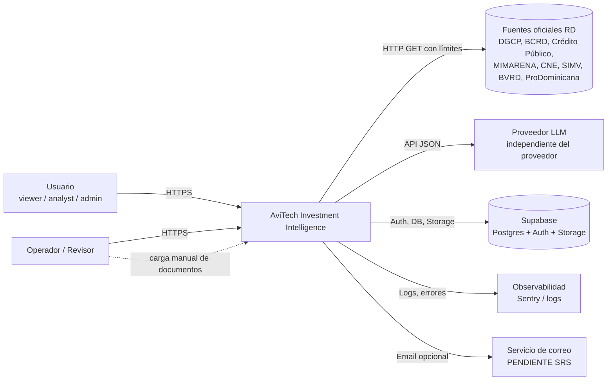
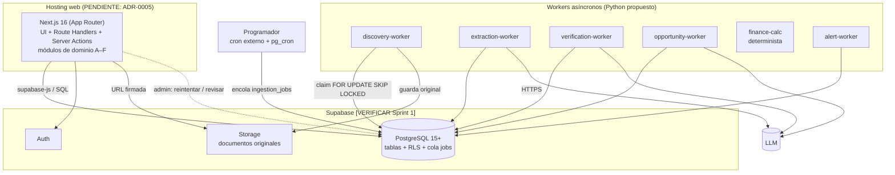
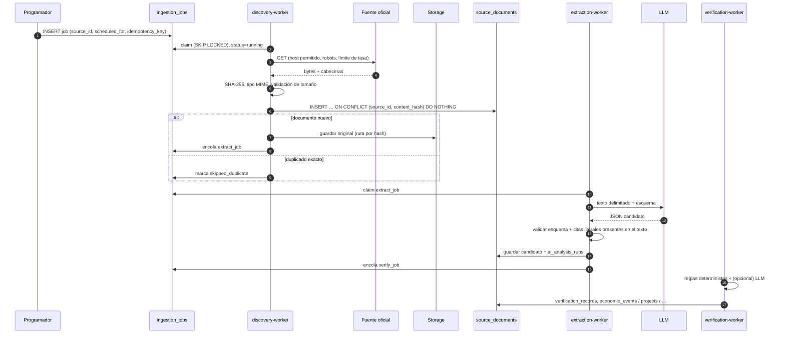
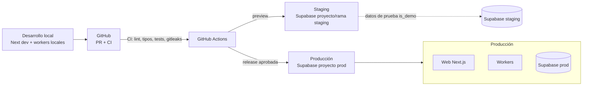

# Arquitectura del MVP — AviTech Investment Intelligence

| Campo | Valor |
|---|---|
| Documento | `docs/arquitectura/ARQUITECTURA-MVP.md` |
| Versión | 0.1.0 (Sprint 0) |
| Fecha | 2026-11-15 |
| Autor | Ventana A |
| Estado | **PROPUESTA PARA APROBACIÓN** — nada de lo descrito está implementado ni probado |
| Requisitos | `[PENDIENTE SRS]`. Base: Prompt Maestro (PM) y `docs/producto/REQUISITOS-Y-TRAZABILIDAD.md` (RF/RNF provisionales de la Ventana B) |

> **Qué es y qué no es este documento.** Es un diseño. No hay código, tablas ni despliegue. Toda cifra de capacidad o rendimiento es una **hipótesis a medir** (ver §11). Lo que depende de Supabase (límites, extensiones, comportamiento de RLS) no se pudo comprobar: el proyecto vinculado no responde (B-003). Se marca `[VERIFICAR Sprint 1]`.

## 1. Resumen de la decisión

**Monolito modular en Next.js 16 (TypeScript) + workers asíncronos desacoplados + PostgreSQL (Supabase) como única fuente de verdad y cola.** Sin microservicios. Los workers de ingesta/extracción se proponen en **Python** (propuesta, no decisión aprobada — ver ADR-0002).

Principios:

1. **El dato manda, la IA propone.** La base de datos y el código determinista deciden estados; el LLM solo extrae o sugiere con evidencia.
2. **Idempotencia en todo el pipeline.** Reejecutar nunca duplica (claves en `MODELO-DATOS.md` §6).
3. **Fuente primero.** Nada sin `source_document` o cita (RN-01 de B).
4. **Una sola base, una sola cola** al inicio: menos piezas, menos fallos, menos coste.
5. **Reversible hasta donde sea posible**; las decisiones irreversibles van en ADR.

## 2. Contexto (C4 nivel 1)

Notas: el correo es `[PENDIENTE SRS]` (V-04 de B). Las fuentes sin acceso automático (F-05…F-07) entran por **carga manual** con el mismo pipeline.

## 3. Contenedores (C4 nivel 2)

Decisiones de este diagrama:

- **Cola = tabla `ingestion_jobs` en Postgres** (`SELECT … FOR UPDATE SKIP LOCKED`). Evita añadir Redis/SQS en el MVP. Límite conocido: sirve para cientos de jobs/hora, no para miles/segundo (ver ADR-0003 y §11).
- **El contenedor web no ejecuta trabajo pesado.** Solo encola y consulta. Las funciones serverless tienen límites de tiempo/memoria `[VERIFICAR Sprint 1 según plan de hosting]`; los bulk de DGCP (cientos de MB, ver `FUENTES-RD.md` F-01) **no** caben ahí.
- **Workers separados del web**, con credenciales distintas (`service_role` solo en workers y rutas servidor, nunca en el cliente).
- Dónde corren los workers (GitHub Actions programado, contenedor en un VPS, Cloud Run, etc.): **decisión abierta** (ADR-0005). Restricción: Docker no está instalado en la máquina de desarrollo (B-006).

## 4. Módulos y límites

Módulos de dominio (carpetas previstas en Sprint 1; hoy **no existen**: `src/lib` no está en el repo):

| Módulo | Responsabilidad | Posee las tablas | No puede |
|---|---|---|---|
| **core** | Identidad, roles, organizaciones, auditoría, configuración | `users`, `organizations`, `audit_logs`, `sectors`, `geographic_locations` | Conocer reglas de negocio de A–F |
| **ingest** | Fuentes, jobs, documentos, deduplicación de documentos | `sources`, `ingestion_jobs`, `source_documents` | Crear eventos |
| **A radar** | Eventos económicos, clasificación, alertas de eventos | `economic_events`, `entity_relationships` (eventos) | Escribir proyectos/instrumentos |
| **B proyectos** | Proyectos y permisos con máquina de estados | `projects`, `permits` | Cambiar estado sin documento |
| **C instrumentos** | Instrumentos, subastas, cálculo | `financial_instruments`, `instrument_auctions` | Mostrar "comprar" |
| **D licitaciones** | Licitaciones y contratos | `public_tenders`, `contracts` | — |
| **E expansión** | Empresas (organizaciones tipo `company`), relaciones | `entity_relationships` (empresas) | — |
| **F oportunidades** | Oportunidades, evidencia, verificación | `investment_opportunities`, `opportunity_evidence`, `verification_records` | Publicar sin revisión humana |
| **ai** | Ejecuciones de agentes, trazabilidad | `ai_analysis_runs` | Escribir tablas de dominio saltándose validadores |
| **alerts** | Preferencias, watchlists, notificaciones | `watchlists`, `user_alert_preferences`, `notifications` | — |

Regla de dependencia: `A–F → ingest → core`. **Nunca** al revés. Los módulos A–F no se leen entre sí tablas directamente: usan funciones/vistas públicas del módulo (contratos §5). Se verificará con una regla de lint de imports `[PENDIENTE Sprint 1]`.

La ficha de empresa usa `organizations` con `type = 'company'` (opción (a) de C-07 de B; **pendiente de aprobación**).

## 5. Contratos entre módulos

Contratos de lectura/escritura (TypeScript en el web, JSON Schema compartido con workers; código en Sprint 1):

| Contrato | Productor → consumidor | Forma | Garantías |
|---|---|---|---|
| `DocumentIngested` | ingest → extraction | `{source_document_id, content_hash, mime, storage_path, source_id}` | Documento inmutable; hash verificado |
| `EventCandidate` | extraction → A | JSON validado (SISTEMA-IA §4.2) | Cada campo trae `evidence[]` |
| `VerificationResult` | verification → A/F | `{subject_type, subject_id, status, reasons[]}` | Estados: `verified`, `partially_verified`, `disputed`, `unverifiable` |
| `OpportunityDraft` | opportunity → F | JSON validado (SISTEMA-IA §4.4) | `status = draft`; no publica |
| `AlertDue` | A/B/C/D/F → alerts | `{entity_type, entity_id, reason, dedup_key}` | `dedup_key` único por usuario |

Eventos entre módulos se transmiten **por la base de datos** (tabla de estado + `ingestion_jobs`), no por mensajería externa. Cada transición deja fila en `audit_logs`.

## 6. Flujo de ingesta

Reglas del flujo:

- **Reintentos:** hasta 3 con backoff exponencial y jitter; luego `dead` + alerta operativa (RNF-07 de B).
- **Idempotencia:** `idempotency_key = hash(source_id, scheduled_window)` en el job y `UNIQUE (source_id, content_hash)` en documentos.
- **Carga manual:** el panel admin crea el mismo `source_document` con `ingest_method = 'manual_upload'` y el actor en `audit_logs`.
- **Cambio de esquema en la fuente** (p. ej. XLS BCRD): el parser falla cerrado, marca el job `failed_schema`, no inserta nada y alerta.

## 7. Colas, programación y observabilidad

**Cola.** `ingestion_jobs` con estados `queued → running → succeeded | failed | dead | skipped_duplicate`, `attempts`, `locked_by`, `locked_until` (lease). Un worker caído libera el job al expirar el lease.

**Programación.** Dos candidatos, no excluyentes: (1) `pg_cron` de Supabase `[VERIFICAR Sprint 1]` para encolar jobs por fuente; (2) un cron externo (GitHub Actions `schedule` o equivalente) que llama a un endpoint protegido con `INGESTION_CRON_SECRET` (variable ya prevista en `.env.example`). El cron **solo encola**; los workers ejecutan. Zona horaria de referencia `America/Santo_Domingo` (UTC−4, sin horario de verano); almacenamiento en UTC.

**Observabilidad (mínimos propuestos, medir en Sprint 1+):**

| Señal | Fuente | Alerta |
|---|---|---|
| Jobs por estado y edad del más antiguo en `queued` | SQL sobre `ingestion_jobs` | Cola atascada > umbral `[PENDIENTE]` |
| Fallos por fuente | `ingestion_jobs.error_class` | ≥3 fallos consecutivos |
| Frescura por fuente | `max(detected_at)` vs. expectativa | Fuente sin datos nuevos > umbral por fuente |
| Costo y tokens IA | `ai_analysis_runs` | Presupuesto mensual `AI_MONTHLY_BUDGET_USD` |
| Errores de aplicación | Sentry (variable `SENTRY_DSN` prevista) | Tasa de error |
| Auditoría anómala | `audit_logs` | Cambios de rol fuera de horario |

Logs estructurados con `request_id`/`job_id` (RNF-35 de B). Ningún dato personal en logs.

## 8. Despliegue (propuesta)

Separación de entornos (PM §10): proyectos Supabase distintos para staging y prod; secretos distintos; datos `is_demo` solo en staging (C-11 de B). **El proyecto Supabase vinculado hoy (`ecmqmgpruxclmpnnpgzv`) no está confirmado como el de este producto (B-003): no se usa.** Hosting web y de workers: ADR-0005 (abierto).

## 9. Alternativas consideradas

| # | Decisión | Alternativa | Por qué no (en el MVP) |
|---|---|---|---|
| ALT-1 | Monolito modular | **Microservicios** por módulo A–F | Un equipo pequeño; sin SRS de carga; coste de red, despliegue, observabilidad distribuida, contratos versionados y consistencia entre servicios sin beneficio demostrado. Los módulos comparten datos relacionales fuertes (evento→oportunidad→evidencia). **Reevaluar** si una métrica medida (RNF-02/04) lo exige. El PM §7 ya lo desaconseja. |
| ALT-2 | Cola en Postgres | Redis/BullMQ, SQS, RabbitMQ | Otra pieza que operar, vigilar y asegurar. Con el volumen esperado `[PENDIENTE]` basta Postgres. Se migra detrás de una interfaz `JobQueue` si se mide saturación. |
| ALT-3 | Workers Python | Todo en TypeScript | Python tiene mejor ecosistema de ETL/parsing de XLSX/PDF. Coste: dos runtimes, dos cadenas de CI. **No es una decisión aprobada** (D-001/ORQ). Alternativa válida: todo TS con `exceljs`/`pdfjs`. Impacto: ADR-0002. |
| ALT-4 | Postgres FTS para búsqueda | Elasticsearch/Meilisearch/Typesense | `tsvector` + `pg_trgm` cubren el volumen inicial `[MEDIR vs. RNF-03]`. Servicio de búsqueda externo solo si el benchmark falla. |
| ALT-5 | Supabase | Postgres autogestionado / Neon / RDS | PM §7 lo prefiere; Auth+RLS+Storage reducen código. Riesgo: acoplamiento a Supabase Auth (ADR-0004). |
| ALT-6 | Documentos en Supabase Storage | S3/R2 | Menos piezas; Cloudflare R2 queda como salida si el costo crece `[VERIFICAR]`. |
| ALT-7 | LLM vía capa propia (adapter) | SDK de un proveedor directamente | PM exige independencia del proveedor. La capa es una interfaz fina, no un framework. |
| ALT-8 | Scraping de sitios sin API | Solo APIs/bulk/CSV | Se descarta por defecto: fuentes con WAF o términos desconocidos. HTML solo si `robots.txt` y términos lo permiten (ver FUENTES-RD §13). |
| ALT-9 | RAG con base vectorial dedicada | `pgvector` en la misma base | `pgvector` evita otra base. **No** se incluye en el MVP salvo necesidad demostrada (no hay requisito que lo exija; la verificación usa citas literales). `[VERIFICAR Sprint 1 si pgvector está disponible]` |

## 10. Riesgos técnicos

Probabilidad (P) e impacto (I): A=alta, M=media, B=baja. Valores **estimados por juicio**, sin datos.

| ID | Riesgo | P | I | Mitigación | Dueño |
|---|---|---|---|---|---|
| RT-01 | Fuentes bloquean o cambian formato (403/473 ya observados) | A | A | Carga manual como camino de primera clase; validación de esquema; alertas de frescura | A |
| RT-02 | Licencias de reutilización inciertas (BVRD `ai-train=no`) | A | A | Abogado; no automatizar BVRD; no usar su contenido para entrenar | Usuario |
| RT-03 | Supabase no verificado: RLS/extensiones/cron distintos a lo supuesto | M | A | Prueba de humo en rama de Supabase antes de Sprint 1 (T-INF-01); SQL con alternativas | A |
| RT-04 | Alucinación o cifras inventadas por LLM | M | A | Validador determinista de citas; revisión humana en MVP; evals antes de automatizar | A |
| RT-05 | Prompt injection desde documentos externos | M | A | Aislamiento, esquema estricto, sin herramientas con efectos, evals adversariales (SISTEMA-IA §8) | A |
| RT-06 | Bulk DGCP (cientos de MB) rompe memoria/tiempo | A | M | Procesamiento en streaming (`.jsonl.gz` línea a línea), worker dedicado, no serverless | A |
| RT-07 | Cola en Postgres satura o bloquea la base | B | M | Índices parciales, lease corto, límites de concurrencia; interfaz `JobQueue` | A |
| RT-08 | Costo IA se dispara | M | M | Tope mensual duro, caché por `content_hash`, modelo barato primero (SISTEMA-IA §9) | A |
| RT-09 | Next.js 16 con APIs distintas a lo conocido | M | M | Leer `node_modules/next/dist/docs/` antes de codificar (AGENTS.md); no depender de APIs sin comprobar | A/B |
| RT-10 | Duplicados de empresas/eventos | A | M | Claves y reglas en `MODELO-DATOS.md` §6; fusiones reversibles | A |
| RT-11 | Fuga de datos por RLS mal diseñada | B | A | Suite de pruebas RLS por rol (RNF-24); `service_role` solo servidor | A |
| RT-12 | Proyecto en OneDrive (sincronización) | A | B | `node_modules`/`.next` fuera de OneDrive (ya hecho: junction); aprobado en auditoría | Usuario |
| RT-13 | Dos runtimes (TS+Python) aumentan complejidad | M | M | Contratos JSON Schema únicos; CI para ambos; opción de unificar en TS (ADR-0002) | A |
| RT-14 | Requisitos cambian al llegar la SRS | A | M | Matriz de trazabilidad; ADRs reversibles; no cerrar modelo de datos sin SRS | A/B |

## 11. Objetivos medibles (métodos; sin resultados)

Las metas son las **propuestas de la Ventana B** (RNF-01…RNF-37). Desde la arquitectura, qué medir y cómo:

| Área | Qué medir | Cómo | Cuándo |
|---|---|---|---|
| Capacidad cola | jobs/min y latencia de `claim` | Benchmark con 10× el volumen esperado en staging | Sprint 1 |
| Búsqueda | p95 de 10 consultas frecuentes | `EXPLAIN (ANALYZE)` + k6 con 100 000 eventos sintéticos | Fase 4 |
| Bulk DGCP | memoria pico y tiempo de carga completa | Ejecutar con archivo real en entorno de worker | Fase 3 |
| RLS | casos rol × entidad | Suite automatizada | Fase 4 |
| Frescura | `detected_at − published_at` por fuente | Consulta diaria | Fase 3+ |

**Ningún objetivo se declara cumplido en Sprint 0.**

## 12. Cuestiones abiertas para el usuario

| ID | Pregunta | Recomendación |
|---|---|---|
| Q-A1 | ¿Se aprueba monolito modular + workers + cola en Postgres? | Sí (ADR-0001, ADR-0003) |
| Q-A2 | ¿Workers en Python o todo en TypeScript? | Decidir tras Q-A4; propuesta Python (ADR-0002) |
| Q-A3 | ¿Qué proyecto Supabase es el de este producto? | Crear uno nuevo "avitech-investment-intelligence" (B-003) |
| Q-A4 | ¿Dónde corren los workers y el web? (Vercel, Cloudflare, VPS, Cloud Run) | Abierto: ADR-0005 |
| Q-A5 | ¿Qué proveedor de LLM y qué presupuesto mensual? | `[PENDIENTE]` (B: RNF-21) |
| Q-A6 | ¿Una sola organización o multi-tenant? | Una organización, con `organization_id` (C-12 de B) |

## 13. Trazabilidad con requisitos de B

| Tema | Requisitos B | Dónde se atiende |
|---|---|---|
| Ingesta y evidencia | RF-A-01, A-04, A-05, RNF-06 | §6; `MODELO-DATOS.md` §6 |
| Estados de proyecto | RF-B-03, B-04 | `MODELO-DATOS.md` §5 (constraints) |
| Tasas indicativas/adjudicadas | RF-C-05 | `MODELO-DATOS.md` (enum `rate_kind`) |
| Revisión humana | RF-F-11, RN-07 | `SISTEMA-IA.md` §7 |
| Auditoría | RF-G-13, RNF-25 | `MODELO-DATOS.md` §8 |
| RLS | RF-G-02, RNF-24 | `MODELO-DATOS.md` §7 |
