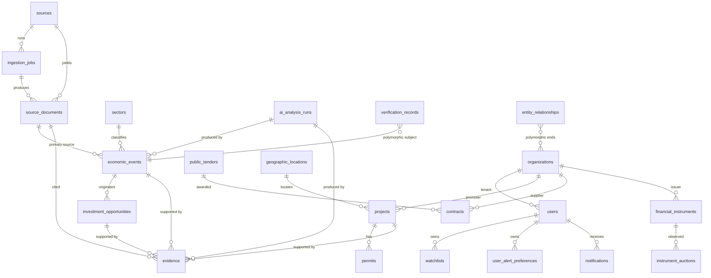

# Modelo de datos — AviTech Investment Intelligence

| Campo | Valor |
|---|---|
| Documento | `docs/datos/MODELO-DATOS.md` (acompaña a `schema-propuesto.sql`) |
| Versión | 0.1.0 (Sprint 0) |
| Fecha | 2026-11-15 |
| Autor | Ventana A |
| Estado | **PROPUESTA — NO APLICADA, NO PROBADA** |
| Requisitos | `[PENDIENTE SRS]`. Base: Prompt Maestro §8 y `docs/producto/REQUISITOS-Y-TRAZABILIDAD.md` |

> **Honestidad de estado.** El SQL no se ejecutó en ningún motor: no hay `psql`, Docker ni Supabase accesible (B-003, B-006). Fue revisado a mano. Antes de Sprint 1 debe correr en una base vacía de Postgres 15+ y pasar la suite de pruebas RLS (T-DB-01…03). Cada punto dependiente de Supabase lleva `[VERIFICAR Sprint 1]`.

## 1. Alcance

Las **23 entidades** del PM §8, ni una más ni una menos (verificado contando `CREATE TABLE` de tablas de negocio en el SQL; las 2 particiones iniciales y la `default` de `audit_logs` son particiones de una sola entidad). Tablas auxiliares: ninguna. Funciones auxiliares en el esquema `app`.

| # | Entidad | Módulo | Función (justificación) |
|---|---|---|---|
| 1 | `users` | core | Perfil, rol y preferencias; enlaza con Auth |
| 2 | `organizations` | core/E | Empresas, instituciones y el tenant (ver §3, riesgo) |
| 3 | `sources` | ingest | Registro de fuentes con estado legal; impide activar conectores no verificados |
| 4 | `source_documents` | ingest | Documento original inmutable, hash, fechas |
| 5 | `ingestion_jobs` | ingest | Cola y trazabilidad de ejecuciones |
| 6 | `economic_events` | A | Acontecimientos |
| 7 | `projects` | B | Fichas de proyecto |
| 8 | `permits` | B | Permisos y autorizaciones |
| 9 | `public_tenders` | D | Licitaciones |
| 10 | `contracts` | D | Adjudicaciones/contratos |
| 11 | `financial_instruments` | C | Instrumentos |
| 12 | `instrument_auctions` | C | Subastas y observaciones de tasa (historial) |
| 13 | `investment_opportunities` | F | Oportunidades |
| 14 | `evidence` | F/A | Evidencia citada (generalizada, ver §3) |
| 15 | `sectors` | ref | 11 categorías del PM |
| 16 | `geographic_locations` | ref | Jerarquía geográfica |
| 17 | `entity_relationships` | E | Aristas entre entidades |
| 18 | `watchlists` | alerts | Elementos guardados |
| 19 | `user_alert_preferences` | alerts | Configuración de alertas |
| 20 | `notifications` | alerts | Bandeja y entrega |
| 21 | `ai_analysis_runs` | ai | Trazabilidad de cada ejecución de IA |
| 22 | `verification_records` | A/F | Historial de verificación |
| 23 | `audit_logs` | core | Auditoría inmutable |

## 2. Diagrama entidad-relación (simplificado)

`entity_relationships`, `watchlists` y `verification_records` son **polimórficas** (apuntan a varias tablas sin FK real). Se compensa con la función de vigilancia `app.orphan_relationships()` y con borrado lógico (no se borra desde la app). Es un compromiso aceptado: la alternativa son tablas de unión por pareja de entidades (más tablas, el PM pide no crearlas sin justificar).

## 3. Decisiones de modelado y puntos abiertos

| ID | Decisión / riesgo | Detalle | Estado |
|---|---|---|---|
| DM-01 | **`organizations` mezcla tenant y empresas** | C-07 (B) pide `organizations` para empresas y C-12/RF-G-03 pide pertenencia de usuarios a una organización. Se resuelve con `org_type` (`tenant` vs. `company`/`government`/…) y un trigger que obliga a `users.organization_id` a ser `tenant`. **Riesgo:** una tabla con dos significados; una política mal escrita podría exponer tenants. Alternativa: separar `tenants`, pero eso sería la entidad 24. | **Aprobado en G0 #10** (2026-11-15) |
| DM-02 | **Sin SRS** | Campos, enumeraciones y reglas derivan del PM y de los RF provisionales de B. | `[PENDIENTE SRS]` |
| DM-03 | **`evidence` se usa para todos los sujetos** (antes `opportunity_evidence`) | RF-A-05 exige evidencia por evento y RN-06 por cifra; el nombre original del PM solo habla de oportunidades, por eso se renombra la tabla a `evidence` (no cambia el conteo de 23). La columna `opportunity_id` y el índice `evidence_opp_idx` se mantienen. | **Aprobado en G0 #10** — renombrar a evidence antes de ejecutar el SQL |
| DM-04 | `instrument_auctions` guarda también `rate_observation` | Para el historial de tasas indicativas/efectivas sin crear otra tabla. El nombre es engañoso; la columna `auction_type` lo aclara. | Pendiente |
| DM-05 | Un evento con `primary_source_document_id` + más fuentes en `entity_relationships`/evidencia | C-08 (B): hecho originador singular + secundarios. | Alineado con B, pendiente de aprobación |
| DM-06 | Vistas guardadas de búsqueda (RF-G-05, Should) **no tienen tabla** | Requeriría la entidad 24. Se pospone. | **Fuera del MVP — G0 #9** (post-MVP; sin tabla) |
| DM-07 | Datos de usuario y Auth | `users.id = auth.users.id` (FK comentada) | `[VERIFICAR Sprint 1]` |
| DM-08 | Cobertura geográfica | Sin catálogo oficial de provincias/municipios cargado: se sembrará desde fuente oficial, no de memoria | `[PENDIENTE]` |

## 4. Enumeraciones

Definidas con `CREATE TYPE … AS ENUM`. Agregar valores es posible (`ALTER TYPE … ADD VALUE`); **quitar o renombrar no lo es** sin migración compleja. Por eso los valores no definidos por la fuente se dejan abiertos como `text` (p. ej. `permits.category`, `economic_events.event_kind`).

| Enum | Valores | Origen |
|---|---|---|
| `user_role` | viewer, analyst, opportunity_manager, org_admin, platform_admin | Propuesta B (RF-G-02) |
| `project_status` | announced, permit_applied, permit_approved, under_construction, operating, suspended, cancelled, unknown | Propuesta B (RF-B-03); PM §4-B |
| `verification_status` | pending, verified, partially_verified, disputed, unverifiable | B (RF-A-11) + `pending` inicial |
| `rate_kind` | indicative, awarded, effective | PM §4-C |
| `trust_layer` | confirmed, ai_analysis, inference | AGENTS.md regla 9 |
| `publication_status` | draft, in_review, published, rejected | B (RF-F-11) |
| `opportunity_type` | 11 tipos | PM §4-F |
| `entity_type`, `job_type`, `job_status`, `permit_*`, `tender_status`, `instrument_type`, `auction_type`, `alert_*` | ver SQL | Propuestas A, `[PENDIENTE SRS]` |

## 5. Restricciones de integridad que implementan reglas del producto

| Regla | Restricción | Dónde |
|---|---|---|
| RF-B-04 / RN-03: registro ≠ aprobación | `CHECK` en `projects`: `permit_approved`, `under_construction` y `operating` exigen `official_document_id`. En `permits`: `approved` exige documento. | SQL §7.2, 7.3 |
| RN-06: cifra con cita | `projects.announced_amount` exige `currency` y `amount_source_document_id`; `instrument_auctions.source_document_id NOT NULL` | SQL |
| RNF-14: monto con moneda | `CHECK (amount IS NULL OR currency IS NOT NULL)` en todas las tablas con importes | SQL |
| RF-C-05: tasas separadas | `rate_kind NOT NULL` en subastas; `cutoff_rate` solo con `rate_kind = 'awarded'` | SQL §7.7 |
| RF-C-12: sin disponibilidad supuesta | `availability` por defecto `not_confirmed`; `confirmed_by_source` exige documento | SQL §7.6 |
| RF-F-01/F-04/F-11, RN-07: publicar oportunidad | Trigger `enforce_opportunity_publication`: solo usuario con rol de gestión, revisor = quien actúa, evento originador `verified`/`partially_verified`, ≥1 evidencia con cita literal verificada. **Un worker o `service_role` no puede publicar.** | SQL §7.11 |
| PM §6: sin conectores sin verificación legal | `CHECK` en `sources`: activo y automático ⇒ `automation_allowed` y `legal_status='verified_ok'` | SQL §5.1 |
| RF-A-04 / RNF-06 | `UNIQUE (source_id, content_hash)` | SQL §5.3 |
| Documento original inmutable | Trigger `source_documents_immutable` | SQL §5.3 |
| Auditoría inmutable | Trigger bloquea UPDATE/DELETE en `audit_logs` | SQL §10 |
| RF-B-07: sin geocodificación inventada | `CHECK`: coordenadas exigen `coordinates_source` | SQL §3.3 |
| Calidad de datos de DGCP | **No** se impone `start_date <= end_date` en `contracts`: la fuente declara inconsistencias (OCP ficha 22). Se marca `data_quality_flags`. | SQL §7.5 |

## 6. Estrategia de deduplicación

Principio: **la clave determinista decide los duplicados exactos; la similitud solo propone candidatos** y un humano o una regla explícita los fusiona. Las fusiones son **reversibles** (`merged_into_id`, nunca `DELETE`) y quedan en `audit_logs`.

### 6.1 Documentos (`source_documents`)

| Nivel | Clave | Acción |
|---|---|---|
| Exacto | `UNIQUE (source_id, content_hash)` (SHA-256 del contenido bruto) | `INSERT … ON CONFLICT DO NOTHING`; el job queda `skipped_duplicate` |
| Nueva versión | Mismo `(source_id, external_id)` y hash distinto | Se inserta y `supersedes_id` apunta a la anterior; no se sobrescribe |
| Mismo contenido, otra URL | Mismo hash en la misma fuente | Se conserva la primera URL; las otras no se almacenan |
| Cruce de fuentes | Mismo hash en fuentes distintas | Dos filas (la fuente es parte de la procedencia) |

### 6.2 Eventos (`economic_events`)

`dedup_key = sha256( fecha_ancla ‖ tipo ‖ organización_normalizada ‖ título_normalizado )`

- `fecha_ancla` = `occurred_at` si existe, si no `published_at` truncada al día (UTC).
- `título_normalizado` = minúsculas, sin acentos ni puntuación, espacios colapsados, sin palabras vacías `[PENDIENTE: lista]`.
- `UNIQUE (dedup_key) WHERE merged_into_id IS NULL`.
- **Casi-duplicados:** `similarity(title) ≥ 0,80` (pg_trgm, umbral inicial a calibrar con el golden set), mismo `organization_id` y ventana de ±7 días → se crea candidato de fusión, **no** fusión automática. Umbral: `[A CALIBRAR con evals]`.
- Un evento puede tener varias fuentes: la segunda fuente añade evidencia al evento existente, no un evento nuevo.

### 6.3 Oportunidades (`investment_opportunities`)

`dedup_key = sha256( originating_event_id ‖ opportunity_type ‖ sector_id ‖ location_id )`, único mientras no esté `rejected` y no sea una versión (`supersedes_id IS NULL`). Recalcular crea una versión nueva (`version+1`, `supersedes_id`), no una fila duplicada.

### 6.4 Otras entidades

| Entidad | Clave |
|---|---|
| `organizations` | `UNIQUE (country, tax_id)` si hay RNC; si no, `normalized_name` + similitud (candidatos). Variantes de razón social → fusión revisada (RF-E-08). |
| `projects` | `sha256(promotor_normalizado ‖ nombre_normalizado ‖ location_id)`; si existe `file_number` de permiso, se prefiere ese vínculo. Proyectos "relacionados" no se fusionan (RF-B-11). |
| `permits` | `UNIQUE (source_id, external_id)`; `dedup_key = sha256(source_id ‖ file_number ‖ permit_type)` |
| `public_tenders`, `contracts` | `UNIQUE (source_id, external_id)` (OCID) |
| `financial_instruments` | `UNIQUE (isin)` si existe; si no, `sha256(emisor ‖ tipo ‖ moneda ‖ vencimiento ‖ nombre_normalizado)` |
| `instrument_auctions` | `UNIQUE (instrument_id, auction_type, auction_date, rate_kind)` |
| `notifications` | `UNIQUE (user_id, channel, dedup_key)`; `dedup_key = sha256(reason ‖ entity_type ‖ entity_id ‖ ventana)` (ventana = día para digest; id de versión para cambio de estado) |
| `ai_analysis_runs` | `UNIQUE (agent, idempotency_key)`; `idempotency_key = sha256(agent ‖ input_hash ‖ prompt_version ‖ schema_version ‖ model)` |

Límites conocidos: los hashes de contenido fallan ante cambios cosméticos del documento (marca de agua, fecha de impresión) ⇒ llegan como "nueva versión"; el costo es almacenamiento extra, no datos duplicados en `economic_events` (porque ahí manda la clave semántica). Se medirá en el piloto (RNF-12 de B: ≤ 2 % de duplicados).

## 7. Seguridad: RLS por tabla y rol

Roles de base de datos (Supabase): `anon`, `authenticated`, `service_role`. Roles de aplicación (`users.role`): `viewer`, `analyst`, `opportunity_manager`, `org_admin`, `platform_admin`, evaluados por funciones `app.is_staff()`, `app.is_manager()`, etc.

**Principios** (todos implementados en el SQL, no probados):

1. **Denegar por defecto.** `REVOKE ALL` a `anon`/`authenticated` y `GRANT` mínimo; luego RLS. En Supabase los privilegios por defecto concederían acceso a tablas nuevas `[VERIFICAR Sprint 1]`, por eso se revoca explícitamente.
2. **`anon` no tiene acceso a ninguna tabla.** El producto exige sesión (PM §16); la landing es estática. Esto elimina una superficie de ataque con coste cero.
3. **`service_role` omite RLS** (atributo `BYPASSRLS` de Supabase `[VERIFICAR Sprint 1]`). Solo lo usan workers y rutas de servidor; nunca el navegador (`SUPABASE_SERVICE_ROLE_KEY` es solo servidor, ver `.env.example`).
4. **Un worker no puede publicar** oportunidades (trigger) ni cambiar roles.
5. **Cambio de rol solo por `app.set_user_role()`**; la columna `role` no es actualizable por `authenticated`.

### 7.1 Matriz tabla × rol

Leyenda: **S**=SELECT, **I**=INSERT, **U**=UPDATE, **D**=DELETE; `pub`=solo filas `publication_status='published'`; `own`=solo filas propias; `—`=sin acceso. `viewer`/`analyst`/… son roles de aplicación bajo `authenticated`.

| Tabla | `anon` | `viewer` | `analyst` | `opportunity_manager` | `org_admin` / `platform_admin` | `service_role` | Justificación |
|---|---|---|---|---|---|---|---|
| `users` | — | S own | S own | S own | S misma org / platform: todas; U perfil propio | todo | Privacidad; cambio de rol por función |
| `organizations` | — | S (no tenant) pub + su tenant | + I/U (no tenant) | idem | idem; platform: ve todos | todo | Empresas son datos de referencia públicos; tenants privados |
| `sources` | — | S | S | S | S (escritura solo `service_role` en Sprint 1) | todo | Mostrar procedencia; sin secretos en la tabla |
| `source_documents` | — | S (columnas limitadas) | idem | idem | idem | todo | Sin `extracted_text` ni `storage_path` (licencias dudosas); texto y archivo se sirven desde servidor |
| `ingestion_jobs` | — | — | — | — | S | todo | Operativo |
| `economic_events` | — | S pub | S/I/U todos | idem | idem | todo | Borradores internos hasta verificar |
| `projects` | — | S pub | S/I/U | idem | idem | todo | Idem |
| `permits` | — | S pub | S/I/U | idem | idem | todo | Idem |
| `public_tenders` | — | S pub | S/I/U | idem | idem | todo | Datos oficiales estructurados; `pub` por defecto |
| `contracts` | — | S pub | S/I/U | idem | idem | todo | Idem |
| `financial_instruments` | — | S pub | S/I/U | idem | idem | todo | Idem |
| `instrument_auctions` | — | S pub | S/I/U | idem | idem | todo | Idem |
| `investment_opportunities` | — | S pub | S/I/U sobre no publicadas | S/I/U **y publicar** | idem | todo (**no** publica) | RN-07: revisión humana |
| `evidence` | — | S si el sujeto está publicado | S/I/U | idem | idem | todo | Evidencia no debe filtrar borradores |
| `sectors`, `geographic_locations` | — | S | S | S | S | todo | Referencia pública; escritura solo `service_role` |
| `entity_relationships` | — | S pub | S/I/U | idem | idem | todo | Relaciones inferidas no publicadas no se muestran |
| `watchlists` | — | S/I/U/D own | own | own | own | todo | Datos privados; ni los admins los leen |
| `user_alert_preferences` | — | S/I/U/D own | own | own | own | todo | Idem |
| `notifications` | — | S own; U (`read_at`,`status`) own | own | own | own | todo | Creación solo por servidor (Alert Agent) |
| `ai_analysis_runs` | — | — | S | S | S | todo | Trazabilidad para revisores; lectores ven procedencia vía API del servidor |
| `verification_records` | — | S si el sujeto está publicado | S; I (solo `human_review` propia) | idem | idem | todo | Motivo visible para el lector (RF-A-11) |
| `audit_logs` | — | — | — | — | platform: S todo; org_admin: S su organización | todo (INSERT) | Mínimo privilegio; inmutable |

Limitaciones honestas: (a) el modelo `anon/authenticated` no distingue roles de aplicación a nivel de privilegios SQL: se hace con políticas que llaman a funciones `STABLE` (coste por fila; medir en Sprint 1, RNF-24/02); (b) `SELECT *` sobre `source_documents` fallará para `authenticated` por los `GRANT` por columna: el código debe listar columnas; (c) `notifications` permite al usuario fijar `status` libremente (riesgo bajo, solo afecta su bandeja); endurecer en Sprint 1 si procede.

### 7.2 Pruebas RLS requeridas (no ejecutadas)

T-DB-01: para cada una de las 23 tablas × 5 roles × {S,I,U,D} verificar permitido/denegado según la matriz (generada desde un archivo de datos). T-DB-02: intentar `UPDATE users SET role='platform_admin'` como `viewer` ⇒ debe fallar. T-DB-03: `service_role` intenta publicar una oportunidad ⇒ debe fallar. Estas pruebas materializan RNF-24 y AC-MVP-13 de B.

## 8. Retención, historial de cambios y auditoría

### 8.1 Historial de cambios

- **Mecanismo:** trigger `audit_row_change` en 12 tablas (usuarios, organizaciones, fuentes, eventos, proyectos, permisos, licitaciones, contratos, instrumentos, subastas, oportunidades, relaciones) guarda `old_data`/`new_data` completos. Cubre RF-A-12, RF-B-06 y RF-G-13 **sin tablas de historial adicionales**.
- **Costo:** duplica escrituras en tablas auditadas. Para ingesta masiva (bulk DGCP: cientos de miles de contratos) el trigger puede ser un cuello de botella → en cargas masivas se desactiva por sesión **y** se registra un único resumen en `audit_logs` `[DECISIÓN pendiente, Sprint 1]`. No se audita `ai_analysis_runs` (ya es append-only), `ingestion_jobs` ni `notifications` (alto volumen).
- **Versionado de oportunidades:** además del log, `version` + `supersedes_id` (RF-F-14).
- `users` auditado incluye `email` (dato personal) en `old_data/new_data`: se reducirá con una lista de columnas sensibles a omitir `[PENDIENTE LEGAL]`.

### 8.2 Auditoría

`audit_logs`: append-only (trigger + sin GRANT de escritura a `authenticated`), particionada por mes, sin FK al usuario (se conserva al borrar la cuenta; la identidad se seudonimiza, ver §8.3). Eventos que no son cambios de fila (inicio de sesión administrativo, publicación, exportación) los inserta el servidor con `action` explícito. `ip_address` y `user_agent`: dato personal, retención corta.

### 8.3 Retención (propuesta; todos los plazos `[PENDIENTE LEGAL]` y `[PENDIENTE SRS]`)

| Dato | Propuesta | Mecanismo | Nota |
|---|---|---|---|
| `source_documents` (metadatos) | Indefinida | — | Procedencia de hechos publicados |
| Archivos originales (Storage) | Según `sources.retention_days`; por defecto sin borrado mientras haya entidades que los citen | Tarea de purga con **confirmación humana** (Regla 11 PM) | Fuentes de licencia dudosa: evaluar caducidad `REQUIERE ABOGADO` |
| `extracted_text` | Como el archivo | `UPDATE … SET extracted_text = NULL` | Se puede regenerar |
| `ingestion_jobs` | 90 días los exitosos; 1 año los fallidos | `DELETE` por lotes | Valores a validar con volumen real |
| `ai_analysis_runs` | ≥ 1 año (trazabilidad, RN-12) | — | `output` puede crecer; evaluar compresión |
| `audit_logs` | ≥ 1 año en caliente; luego archivo | `DROP` de partición mensual tras exportar | `[PENDIENTE LEGAL]` plazo mínimo |
| `notifications` | 180 días leídas | `DELETE` por lotes | |
| Datos de usuario | Borrado en ≤ 30 días tras solicitud (RNF-28 de B) | Borrado lógico (`deleted_at`) → purga; `CASCADE` en watchlists/prefs/notifications; auditoría seudonimizada | `REQUIERE ABOGADO` (Ley de protección de datos, ver SEGURIDAD §7) |
| Datos `is_demo` | Solo staging | — | C-11 de B |

### 8.4 Backups

Lo declarado aquí es el **requisito** (RPO ≤ 24 h, RTO ≤ 4 h propuestos por B, RNF-09). Lo que ofrece el plan de Supabase elegido **no se verificó** `[VERIFICAR Sprint 1]`; el simulacro de restauración es entregable previo al lanzamiento.

## 9. Migraciones

- Carpeta `supabase/migrations/` (hoy **no existe**; la auditoría la menciona pero el repo no la contiene).
- Un archivo por cambio, con prefijo temporal, **solo hacia adelante** en producción; reversión mediante migración inversa escrita y probada en staging.
- Sin Supabase CLI ni Docker (B-006): se aplican con el MCP/SQL Editor; cada migración se guarda en el repo **antes** de aplicarse. Alternativa: instalar CLI (requiere aprobación).
- Orden propuesto de la migración inicial (el SQL ya sigue este orden): extensiones y roles → tipos → funciones básicas → referencia → identidad → ingesta → IA → negocio → visibilidad → alertas → auditoría → privilegios → RLS.
- `ALTER TYPE … ADD VALUE` no puede ejecutarse dentro de una transacción con uso del nuevo valor: planificar migraciones de enum en pasos separados.

## 10. Índices (resumen y criterio)

- Búsqueda de texto: `tsvector` generado con configuración `spanish` + `GIN` en eventos, proyectos, licitaciones, oportunidades, documentos. `pg_trgm` para nombres. `[MEDIR vs. RNF-03]`; la configuración `spanish` no elimina acentos: si hace falta, `unaccent` `[VERIFICAR Sprint 1]`.
- Filtros frecuentes: índices **parciales** sobre `publication_status = 'published'` (los lectores solo ven eso).
- Cola: índice parcial `WHERE status = 'queued'` y otro para leases vencidos.
- Se añadirán índices solo tras `EXPLAIN` de las 10 consultas principales; el SQL incluye los mínimos evidentes.

## 11. Qué falta para dar el modelo por cerrado

1. SRS (campos y reglas oficiales).
2. Ejecución real en Postgres 15+ y suite RLS (T-DB-01…03).
3. Decisiones DM-01 y DM-03.
4. Catálogos geográficos oficiales y plazos de retención con abogado.
5. Confirmar el proyecto Supabase destino (B-003).

## 12. Ronda 2 (2026-11-15): cambios y puntos abiertos tras leer los documentos de B

Cambios en `schema-propuesto.sql` (editados a mano, **sin ejecutar**; detalle en `docs/sprint-0/CONCILIACION-A-B.md` §4):

1. RLS activado y privilegios revocados de forma explícita en las 3 particiones de `audit_logs`; función `app.create_audit_partition(date)` para las particiones futuras.
2. `users_auth_fk` (FK a `auth.users`) pasa a ser un **paso obligatorio** y *fail-closed* (sección 4.2 "solo Supabase"); en Postgres plano la migración falla salvo opt-out explícito para pruebas.
3. Columna `timezone_assumed` en `source_documents`, `economic_events` y `public_tenders`.

Puntos **propuestos y no aplicados** (esperan decisión del usuario; agrupados en la tarea T-INF-11): DIS-02 (`verification_status` fuera de eventos), DIS-03 (documento por estado de proyecto), DIS-04 (fusión solo `platform_admin`), DIS-06 (visibilidad de `ingestion_jobs`), DIS-07 (última cuenta `platform_admin`), DIS-09 (vínculo permiso→proyecto inferido), DIS-10 (`rule_snapshot` en notificaciones). Además DIS-05 (retención de auditoría frente a historial visible) y DIS-08 (qué datos son "por organización").

El conteo de entidades sigue siendo 23 (`grep`: 26 `CREATE TABLE` = 23 + 3 particiones).
