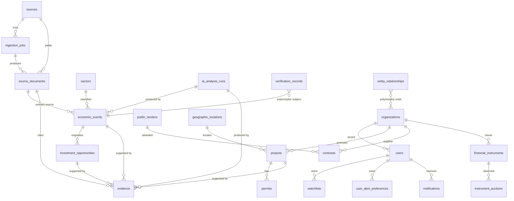

# Modelo de datos — AviTech Investment Intelligence

| Campo | Valor |
|---|---|
| Documento | `docs/datos/MODELO-DATOS.md` (acompaña a `schema-propuesto.sql`) |
| Versión | 0.1.0 (Sprint 0) |
| Fecha | 2026-11-15 |
| Autor | Ventana A |
| Estado | **PROPUESTA — NO APLICADA, NO PROBADA** |
| Requisitos | `[PENDIENTE SRS]`. Base: Prompt Maestro §8 y `docs/producto/REQUISITOS-Y-TRAZABILIDAD.md` |

> **Honestidad de estado.** El SQL no se ejecutó en ningún motor: no hay `psql`, Docker ni Supabase accesible (B-003, B-006). Fue revisado a mano. Antes de Sprint 1 debe correr en una base vacía de Postgres 15+ y pasar la suite de pruebas RLS (T-DB-01…03). Cada punto dependiente de Supabase lleva `[VERIFICAR Sprint 1]`.

## 1. Alcance

Las **23 entidades** del PM §8, ni una más ni una menos (verificado contando `CREATE TABLE` de tablas de negocio en el SQL; las 2 particiones iniciales y la `default` de `audit_logs` son particiones de una sola entidad). Tablas auxiliares: ninguna. Funciones auxiliares en el esquema `app`.

| # | Entidad | Módulo | Función (justificación) |
|---|---|---|---|
| 1 | `users` | core | Perfil, rol y preferencias; enlaza con Auth |
| 2 | `organizations` | core/E | Empresas, instituciones y el tenant (ver §3, riesgo) |
| 3 | `sources` | ingest | Registro de fuentes con estado legal; impide activar conectores no verificados |
| 4 | `source_documents` | ingest | Documento original inmutable, hash, fechas |
| 5 | `ingestion_jobs` | ingest | Cola y trazabilidad de ejecuciones |
| 6 | `economic_events` | A | Acontecimientos |
| 7 | `projects` | B | Fichas de proyecto |
| 8 | `permits` | B | Permisos y autorizaciones |
| 9 | `public_tenders` | D | Licitaciones |
| 10 | `contracts` | D | Adjudicaciones/contratos |
| 11 | `financial_instruments` | C | Instrumentos |
| 12 | `instrument_auctions` | C | Subastas y observaciones de tasa (historial) |
| 13 | `investment_opportunities` | F | Oportunidades |
| 14 | `evidence` | F/A | Evidencia citada (generalizada, ver §3) |
| 15 | `sectors` | ref | 11 categorías del PM |
| 16 | `geographic_locations` | ref | Jerarquía geográfica |
| 17 | `entity_relationships` | E | Aristas entre entidades |
| 18 | `watchlists` | alerts | Elementos guardados |
| 19 | `user_alert_preferences` | alerts | Configuración de alertas |
| 20 | `notifications` | alerts | Bandeja y entrega |
| 21 | `ai_analysis_runs` | ai | Trazabilidad de cada ejecución de IA |
| 22 | `verification_records` | A/F | Historial de verificación |
| 23 | `audit_logs` | core | Auditoría inmutable |

## 2. Diagrama entidad-relación (simplificado)

`entity_relationships`, `watchlists` y `verification_records` son **polimórficas** (apuntan a varias tablas sin FK real). Se compensa con la función de vigilancia `app.orphan_relationships()` y con borrado lógico (no se borra desde la app). Es un compromiso aceptado: la alternativa son tablas de unión por pareja de entidades (más tablas, el PM pide no crearlas sin justificar).

## 3. Decisiones de modelado y puntos abiertos

| ID | Decisión / riesgo | Detalle | Estado |
|---|---|---|---|
| DM-01 | **`organizations` mezcla tenant y empresas** | C-07 (B) pide `organizations` para empresas y C-12/RF-G-03 pide pertenencia de usuarios a una organización. Se resuelve con `org_type` (`tenant` vs. `company`/`government`/…) y un trigger que obliga a `users.organization_id` a ser `tenant`. **Riesgo:** una tabla con dos significados; una política mal escrita podría exponer tenants. Alternativa: separar `tenants`, pero eso sería la entidad 24. | **Aprobado en G0 #10** (2026-11-15) |
| DM-02 | **Sin SRS** | Campos, enumeraciones y reglas derivan del PM y de los RF provisionales de B. | `[PENDIENTE SRS]` |
| DM-03 | **`evidence` se usa para todos los sujetos** (antes `opportunity_evidence`) | RF-A-05 exige evidencia por evento y RN-06 por cifra; el nombre original del PM solo habla de oportunidades, por eso se renombra la tabla a `evidence` (no cambia el conteo de 23). La columna `opportunity_id` y el índice `evidence_opp_idx` se mantienen. | **Aprobado en G0 #10** — renombrar a evidence antes de ejecutar el SQL |
| DM-04 | `instrument_auctions` guarda también `rate_observation` | Para el historial de tasas indicativas/efectivas sin crear otra tabla. El nombre es engañoso; la columna `auction_type` lo aclara. | Pendiente |
| DM-05 | Un evento con `primary_source_document_id` + más fuentes en `entity_relationships`/evidencia | C-08 (B): hecho originador singular + secundarios. | Alineado con B, pendiente de aprobación |
| DM-06 | Vistas guardadas de búsqueda (RF-G-05, Should) **no tienen tabla** | Requeriría la entidad 24. Se pospone. | **Fuera del MVP — G0 #9** (post-MVP; sin tabla) |
| DM-07 | Datos de usuario y Auth | `users.id = auth.users.id` (FK comentada) | `[VERIFICAR Sprint 1]` |
| DM-08 | Cobertura geográfica | Sin catálogo oficial de provincias/municipios cargado: se sembrará desde fuente oficial, no de memoria | `[PENDIENTE]` |

## 4. Enumeraciones

Definidas con `CREATE TYPE … AS ENUM`. Agregar valores es posible (`ALTER TYPE … ADD VALUE`); **quitar o renombrar no lo es** sin migración compleja. Por eso los valores no definidos por la fuente se dejan abiertos como `text` (p. ej. `permits.category`, `economic_events.event_kind`).

| Enum | Valores | Origen |
|---|---|---|
| `user_role` | viewer, analyst, opportunity_manager, org_admin, platform_admin | Propuesta B (RF-G-02) |
| `project_status` | announced, permit_applied, permit_approved, under_construction, operating, suspended, cancelled, unknown | Propuesta B (RF-B-03); PM §4-B |
| `verification_status` | pending, verified, partially_verified, disputed, unverifiable | B (RF-A-11) + `pending` inicial |
| `rate_kind` | indicative, awarded, effective | PM §4-C |
| `trust_layer` | confirmed, ai_analysis, inference | AGENTS.md regla 9 |
| `publication_status` | draft, in_review, published, rejected | B (RF-F-11) |
| `opportunity_type` | 11 tipos | PM §4-F |
| `entity_type`, `job_type`, `job_status`, `permit_*`, `tender_status`, `instrument_type`, `auction_type`, `alert_*` | ver SQL | Propuestas A, `[PENDIENTE SRS]` |

## 5. Restricciones de integridad que implementan reglas del producto

| Regla | Restricción | Dónde |
|---|---|---|
| RF-B-04 / RN-03: registro ≠ aprobación | `CHECK` en `projects`: `permit_approved`, `under_construction` y `operating` exigen `official_document_id`. En `permits`: `approved` exige documento. | SQL §7.2, 7.3 |
| RN-06: cifra con cita | `projects.announced_amount` exige `currency` y `amount_source_document_id`; `instrument_auctions.source_document_id NOT NULL` | SQL |
| RNF-14: monto con moneda | `CHECK (amount IS NULL OR currency IS NOT NULL)` en todas las tablas con importes | SQL |
| RF-C-05: tasas separadas | `rate_kind NOT NULL` en subastas; `cutoff_rate` solo con `rate_kind = 'awarded'` | SQL §7.7 |
| RF-C-12: sin disponibilidad supuesta | `availability` por defecto `not_confirmed`; `confirmed_by_source` exige documento | SQL §7.6 |
| RF-F-01/F-04/F-11, RN-07: publicar oportunidad | Trigger `enforce_opportunity_publication`: solo usuario con rol de gestión, revisor = quien actúa, evento originador `verified`/`partially_verified`, ≥1 evidencia con cita literal verificada. **Un worker o `service_role` no puede publicar.** | SQL §7.11 |
| PM §6: sin conectores sin verificación legal | `CHECK` en `sources`: activo y automático ⇒ `automation_allowed` y `legal_status='verified_ok'` | SQL §5.1 |
| RF-A-04 / RNF-06 | `UNIQUE (source_id, content_hash)` | SQL §5.3 |
| Documento original inmutable | Trigger `source_documents_immutable` | SQL §5.3 |
| Auditoría inmutable | Trigger bloquea UPDATE/DELETE en `audit_logs` | SQL §10 |
| RF-B-07: sin geocodificación inventada | `CHECK`: coordenadas exigen `coordinates_source` | SQL §3.3 |
| Calidad de datos de DGCP | **No** se impone `start_date <= end_date` en `contracts`: la fuente declara inconsistencias (OCP ficha 22). Se marca `data_quality_flags`. | SQL §7.5 |

## 6. Estrategia de deduplicación

Principio: **la clave determinista decide los duplicados exactos; la similitud solo propone candidatos** y un humano o una regla explícita los fusiona. Las fusiones son **reversibles** (`merged_into_id`, nunca `DELETE`) y quedan en `audit_logs`.

### 6.1 Documentos (`source_documents`)

| Nivel | Clave | Acción |
|---|---|---|
| Exacto | `UNIQUE (source_id, content_hash)` (SHA-256 del contenido bruto) | `INSERT … ON CONFLICT DO NOTHING`; el job queda `skipped_duplicate` |
| Nueva versión | Mismo `(source_id, external_id)` y hash distinto | Se inserta y `supersedes_id` apunta a la anterior; no se sobrescribe |
| Mismo contenido, otra URL | Mismo hash en la misma fuente | Se conserva la primera URL; las otras no se almacenan |
| Cruce de fuentes | Mismo hash en fuentes distintas | Dos filas (la fuente es parte de la procedencia) |

### 6.2 Eventos (`economic_events`)

`dedup_key = sha256( fecha_ancla ‖ tipo ‖ organización_normalizada ‖ título_normalizado )`

- `fecha_ancla` = `occurred_at` si existe, si no `published_at` truncada al día (UTC).
- `título_normalizado` = minúsculas, sin acentos ni puntuación, espacios colapsados, sin palabras vacías `[PENDIENTE: lista]`.
- `UNIQUE (dedup_key) WHERE merged_into_id IS NULL`.
- **Casi-duplicados:** `similarity(title) ≥ 0,80` (pg_trgm, umbral inicial a calibrar con el golden set), mismo `organization_id` y ventana de ±7 días → se crea candidato de fusión, **no** fusión automática. Umbral: `[A CALIBRAR con evals]`.
- Un evento puede tener varias fuentes: la segunda fuente añade evidencia al evento existente, no un evento nuevo.

### 6.3 Oportunidades (`investment_opportunities`)

`dedup_key = sha256( originating_event_id ‖ opportunity_type ‖ sector_id ‖ location_id )`, único mientras no esté `rejected` y no sea una versión (`supersedes_id IS NULL`). Recalcular crea una versión nueva (`version+1`, `supersedes_id`), no una fila duplicada.

### 6.4 Otras entidades

| Entidad | Clave |
|---|---|
| `organizations` | `UNIQUE (country, tax_id)` si hay RNC; si no, `normalized_name` + similitud (candidatos). Variantes de razón social → fusión revisada (RF-E-08). |
| `projects` | `sha256(promotor_normalizado ‖ nombre_normalizado ‖ location_id)`; si existe `file_number` de permiso, se prefiere ese vínculo. Proyectos "relacionados" no se fusionan (RF-B-11). |
| `permits` | `UNIQUE (source_id, external_id)`; `dedup_key = sha256(source_id ‖ file_number ‖ permit_type)` |
| `public_tenders`, `contracts` | `UNIQUE (source_id, external_id)` (OCID) |
| `financial_instruments` | `UNIQUE (isin)` si existe; si no, `sha256(emisor ‖ tipo ‖ moneda ‖ vencimiento ‖ nombre_normalizado)` |
| `instrument_auctions` | `UNIQUE (instrument_id, auction_type, auction_date, rate_kind)` |
| `notifications` | `UNIQUE (user_id, channel, dedup_key)`; `dedup_key = sha256(reason ‖ entity_type ‖ entity_id ‖ ventana ‖ released_at/published_at)` (ventana = día para digest; id de versión para cambio de estado). Al despublicar, la notificación pasa a `superseded` y se redacta; al republicar se calcula una clave nueva con el `released_at` (eventos) o `published_at` (oportunidades) refrescado |
| `ai_analysis_runs` | `UNIQUE (agent, idempotency_key)`; `idempotency_key = sha256(agent ‖ input_hash ‖ prompt_version ‖ schema_version ‖ model)` |

Límites conocidos: los hashes de contenido fallan ante cambios cosméticos del documento (marca de agua, fecha de impresión) ⇒ llegan como "nueva versión"; el costo es almacenamiento extra, no datos duplicados en `economic_events` (porque ahí manda la clave semántica). Se medirá en el piloto (RNF-12 de B: ≤ 2 % de duplicados).

## 7. Seguridad: RLS por tabla y rol

Roles de base de datos (Supabase): `anon`, `authenticated`, `service_role`. Roles de aplicación (`users.role`): `viewer`, `analyst`, `opportunity_manager`, `org_admin`, `platform_admin`, evaluados por funciones `app.is_staff()`, `app.is_manager()`, etc.

**Principios** (todos implementados en el SQL, no probados):

1. **Denegar por defecto.** `REVOKE ALL` a `anon`/`authenticated` y `GRANT` mínimo; luego RLS. En Supabase los privilegios por defecto concederían acceso a tablas nuevas `[VERIFICAR Sprint 1]`, por eso se revoca explícitamente.
2. **`anon` no tiene acceso a ninguna tabla.** El producto exige sesión (PM §16); la landing es estática. Esto elimina una superficie de ataque con coste cero.
3. **`service_role` omite RLS** (atributo `BYPASSRLS` de Supabase `[VERIFICAR Sprint 1]`). Solo lo usan workers y rutas de servidor; nunca el navegador (`SUPABASE_SERVICE_ROLE_KEY` es solo servidor, ver `.env.example`).
4. **Un worker no puede publicar** oportunidades (trigger) ni cambiar roles.
5. **Cambio de rol solo por `app.set_user_role()`**; la columna `role` no es actualizable por `authenticated`.

### 7.1 Matriz tabla × rol

Leyenda: **S**=SELECT, **I**=INSERT, **U**=UPDATE, **D**=DELETE; `pub`=solo filas `publication_status='published'`; `own`=solo filas propias; `—`=sin acceso. `viewer`/`analyst`/… son roles de aplicación bajo `authenticated`.

| Tabla | `anon` | `viewer` | `analyst` | `opportunity_manager` | `org_admin` / `platform_admin` | `service_role` | Justificación |
|---|---|---|---|---|---|---|---|
| `users` | — | S own | S own | S own | S misma org / platform: todas; U perfil propio | todo | Privacidad; cambio de rol por función |
| `organizations` | — | S (no tenant) pub + su tenant | + I/U (no tenant) | idem | idem; platform: ve todos | todo | Empresas son datos de referencia públicos; tenants privados |
| `sources` | — | S | S | S | S (escritura solo `service_role` en Sprint 1) | todo | Mostrar procedencia; sin secretos en la tabla |
| `source_documents` | — | S (columnas limitadas) | idem | idem | idem | todo | Sin `extracted_text` ni `storage_path` (licencias dudosas); texto y archivo se sirven desde servidor |
| `ingestion_jobs` | — | — | — | — | S | todo | Operativo |
| `economic_events` | — | S pub (sin `review_notes`/`reviewed_by`) | S/I/U todos; `review_notes`/`reviewed_by` staff-only | idem | idem | todo | Borradores internos hasta verificar; `publisher_role` público |
| `projects` | — | S pub | S/I/U | idem | idem | todo | Idem |
| `permits` | — | S pub | S/I/U | idem | idem | todo | Idem |
| `public_tenders` | — | S pub | S/I/U | idem | idem | todo | Datos oficiales estructurados; `pub` por defecto |
| `contracts` | — | S pub | S/I/U | idem | idem | todo | Idem |
| `financial_instruments` | — | S pub | S/I/U | idem | idem | todo | Idem |
| `instrument_auctions` | — | S pub | S/I/U | idem | idem | todo | Idem |
| `investment_opportunities` | — | S pub (sin `review_notes`/`reviewed_by`) | S/I/U sobre no publicadas; `review_notes`/`reviewed_by` staff-only | S/I/U **y publicar** | idem | todo (**no** publica) | RN-07: revisión humana; `publisher_role` público |
| `evidence` | — | S si el sujeto está publicado | S/I/U | idem | idem | todo | Evidencia no debe filtrar borradores |
| `sectors`, `geographic_locations` | — | S | S | S | S | todo | Referencia pública; escritura solo `service_role` |
| `entity_relationships` | — | S pub | S/I/U | idem | idem | todo | Relaciones inferidas no publicadas no se muestran |
| `watchlists` | — | S/I/U/D own | own | own | own | todo | Datos privados; ni los admins los leen |
| `user_alert_preferences` | — | S/I/U/D own | own | own | own | todo | Idem |
| `notifications` | — | S own; U (`read_at`) own | own | own | own | todo | `status` lo gestiona el servidor; `superseded` al despublicar |
| `ai_analysis_runs` | — | — | S | S | S | todo | Trazabilidad para revisores; lectores ven procedencia vía API del servidor |
| `verification_records` | — | S si el sujeto está publicado (sin `reviewer_id`) | S; I (solo `human_review` propia); `reviewer_id` staff-only | idem | idem | todo | Motivo visible; `reviewer_role` público; identidad staff-only |
| `audit_logs` | — | — | — | — | platform: S todo; org_admin: S su organización | todo (INSERT) | Mínimo privilegio; inmutable |

**Vistas staff-only (B-018).** `staff_economic_events`, `staff_investment_opportunities`, `staff_verification_records` y `staff_users` se conceden a `authenticated`, pero su `WHERE app.is_staff()` devuelve 0 filas a `viewer`. El owner de la vista omite RLS; **no** convertir a `security_invoker` (el rol `authenticated` no tiene las columnas ocultas). `staff_users` no expone `email`.

Limitaciones honestas: (a) el modelo `anon/authenticated` no distingue roles de aplicación a nivel de privilegios SQL: se hace con políticas que llaman a funciones `STABLE` (coste por fila; medir en Sprint 1, RNF-24/02); (b) `SELECT *` sobre `source_documents`, `economic_events`, `investment_opportunities` y `verification_records` fallará para `authenticated` por los `GRANT` por columna: el código debe listar columnas o usar las vistas `staff_*` si el usuario es staff; (c) `notifications` ya no permite al usuario fijar `status`: solo `read_at`; el estado lo fija el servidor (B-019).

### 7.2 Pruebas RLS requeridas (no ejecutadas)

T-DB-01: para cada una de las 23 tablas × 5 roles × {S,I,U,D} verificar permitido/denegado según la matriz (generada desde un archivo de datos). T-DB-02: intentar `UPDATE users SET role='platform_admin'` como `viewer` ⇒ debe fallar. T-DB-03: `service_role` intenta publicar una oportunidad ⇒ debe fallar. Estas pruebas materializan RNF-24 y AC-MVP-13 de B.

**T-DB-04 (B-016…B-019, propuestas; no ejecutadas).** Viewer no puede leer `review_notes`/`reviewed_by`/`reviewer_id` (error de columna) ni obtener filas de las vistas `staff_*`; `analyst` sí las obtiene y ve el nombre del revisor, pero no `email`. Un evento no verificado solo lo publica `manager+`, sin doble llave (auto-revisión auditada). `reviewer_role` se fija al insertar `human_review` y es público; `reviewer_id` es staff-only. Al despublicar, las notificaciones pasan a `superseded`, se redactan y no se pueden revertir; al republicar se genera una clave de deduplicación nueva. `app.pseudonymize_user` deja el perfil seudonimizado, conserva `reviewed_by`/`reviewer_id` y la auditoría no guarda email/nombre/consentimiento. Detalle: `schema-propuesto.sql` P0-12…P0-25.

## 8. Retención, historial de cambios y auditoría

### 8.1 Historial de cambios

- **Mecanismo:** trigger `audit_row_change` en 12 tablas (usuarios, organizaciones, fuentes, eventos, proyectos, permisos, licitaciones, contratos, instrumentos, subastas, oportunidades, relaciones) guarda `old_data`/`new_data` completos. Cubre RF-A-12, RF-B-06 y RF-G-13 **sin tablas de historial adicionales**.
- **Costo:** duplica escrituras en tablas auditadas. Para ingesta masiva (bulk DGCP: cientos de miles de contratos) el trigger puede ser un cuello de botella → en cargas masivas se desactiva por sesión **y** se registra un único resumen en `audit_logs` `[DECISIÓN pendiente, Sprint 1]`. No se audita `ai_analysis_runs` (ya es append-only), `ingestion_jobs` ni `notifications` (alto volumen).
- **Versionado de oportunidades:** además del log, `version` + `supersedes_id` (RF-F-14).
- `users` auditado: `audit_row_change` **redacta** `email`, `display_name`, `consent_accepted_at` y `consent_version` de `old_data`/`new_data` (B-017, 2026-11-15). La identidad se conserva por `id`/`role`; el historial no guarda PII. La redacción se aplica a partir de esta ronda; las filas históricas no existen (el SQL no se ha ejecutado).

### 8.2 Auditoría

`audit_logs`: append-only (trigger + sin GRANT de escritura a `authenticated`), particionada por mes, sin FK al usuario (se conserva al borrar la cuenta; la identidad se seudonimiza, ver §8.3). Eventos que no son cambios de fila (inicio de sesión administrativo, publicación, exportación) los inserta el servidor con `action` explícito. `ip_address` y `user_agent`: dato personal, retención corta.

### 8.3 Retención (propuesta; todos los plazos `[PENDIENTE LEGAL]` y `[PENDIENTE SRS]`)

| Dato | Propuesta | Mecanismo | Nota |
|---|---|---|---|
| `source_documents` (metadatos) | Indefinida | — | Procedencia de hechos publicados |
| Archivos originales (Storage) | Según `sources.retention_days`; por defecto sin borrado mientras haya entidades que los citen | Tarea de purga con **confirmación humana** (Regla 11 PM) | Fuentes de licencia dudosa: evaluar caducidad `REQUIERE ABOGADO` |
| `extracted_text` | Como el archivo | `UPDATE … SET extracted_text = NULL` | Se puede regenerar |
| `ingestion_jobs` | 90 días los exitosos; 1 año los fallidos | `DELETE` por lotes | Valores a validar con volumen real |
| `ai_analysis_runs` | ≥ 1 año (trazabilidad, RN-12) | — | `output` puede crecer; evaluar compresión |
| `audit_logs` | ≥ 1 año en caliente; luego archivo | `DROP` de partición mensual tras exportar | `[PENDIENTE LEGAL]` plazo mínimo |
| `notifications` | 180 días leídas | `DELETE` por lotes | |
| Datos de usuario | Borrado en ≤ 30 días tras solicitud (RNF-28 de B) | Seudonimización (`app.pseudonymize_user`: email/nombre/consentimiento) + `auth.users` deshabilitado/anonimizado; el perfil se conserva porque `reviewed_by`/`reviewer_id` son `ON DELETE RESTRICT`; auditoría seudonimizada | `REQUIERE ABOGADO` (Ley de protección de datos, ver SEGURIDAD §7) |
| Datos `is_demo` | Solo staging | — | C-11 de B |

### 8.4 Backups

Lo declarado aquí es el **requisito** (RPO ≤ 24 h, RTO ≤ 4 h propuestos por B, RNF-09). Lo que ofrece el plan de Supabase elegido **no se verificó** `[VERIFICAR Sprint 1]`; el simulacro de restauración es entregable previo al lanzamiento.

## 9. Migraciones

- Carpeta `supabase/migrations/` (hoy **no existe**; la auditoría la menciona pero el repo no la contiene).
- Un archivo por cambio, con prefijo temporal, **solo hacia adelante** en producción; reversión mediante migración inversa escrita y probada en staging.
- Sin Supabase CLI ni Docker (B-006): se aplican con el MCP/SQL Editor; cada migración se guarda en el repo **antes** de aplicarse. Alternativa: instalar CLI (requiere aprobación).
- Orden propuesto de la migración inicial (el SQL ya sigue este orden): extensiones y roles → tipos → funciones básicas → referencia → identidad → ingesta → IA → negocio → visibilidad → alertas → auditoría → privilegios → RLS.
- `ALTER TYPE … ADD VALUE` no puede ejecutarse dentro de una transacción con uso del nuevo valor: planificar migraciones de enum en pasos separados.

## 10. Índices (resumen y criterio)

- Búsqueda de texto: `tsvector` generado con configuración `spanish` + `GIN` en eventos, proyectos, licitaciones, oportunidades, documentos. `pg_trgm` para nombres. `[MEDIR vs. RNF-03]`; la configuración `spanish` no elimina acentos: si hace falta, `unaccent` `[VERIFICAR Sprint 1]`.
- Filtros frecuentes: índices **parciales** sobre `publication_status = 'published'` (los lectores solo ven eso).
- Cola: índice parcial `WHERE status = 'queued'` y otro para leases vencidos.
- Se añadirán índices solo tras `EXPLAIN` de las 10 consultas principales; el SQL incluye los mínimos evidentes.

## 11. Qué falta para dar el modelo por cerrado

1. SRS (campos y reglas oficiales).
2. Ejecución real en Postgres 15+ y suite RLS (T-DB-01…03).
3. Decisiones DM-01 y DM-03.
4. Catálogos geográficos oficiales y plazos de retención con abogado.
5. Confirmar el proyecto Supabase destino (B-003).

## 12. Ronda 2 (2026-11-15): cambios y puntos abiertos tras leer los documentos de B

Cambios en `schema-propuesto.sql` (editados a mano, **sin ejecutar**; detalle en `docs/sprint-0/CONCILIACION-A-B.md` §4):

1. RLS activado y privilegios revocados de forma explícita en las 3 particiones de `audit_logs`; función `app.create_audit_partition(date)` para las particiones futuras.
2. `users_auth_fk` (FK a `auth.users`) pasa a ser un **paso obligatorio** y *fail-closed* (sección 4.2 "solo Supabase"); en Postgres plano la migración falla salvo opt-out explícito para pruebas.
3. Columna `timezone_assumed` en `source_documents`, `economic_events` y `public_tenders`.

Puntos **propuestos y no aplicados** (esperan decisión del usuario; agrupados en la tarea T-INF-11): DIS-02 (`verification_status` fuera de eventos), DIS-03 (documento por estado de proyecto), DIS-04 (fusión solo `platform_admin`), DIS-06 (visibilidad de `ingestion_jobs`), DIS-07 (última cuenta `platform_admin`), DIS-09 (vínculo permiso→proyecto inferido), DIS-10 (`rule_snapshot` en notificaciones). Además DIS-05 (retención de auditoría frente a historial visible) y DIS-08 (qué datos son "por organización").

El conteo de entidades sigue siendo 23 (`grep`: 26 `CREATE TABLE` = 23 + 3 particiones).

## 13. Ronda 4 (2026-11-15): guardia de publicación de eventos (P0)

**Problema detectado.** B añadió CC-23 (todo evento no verificado al 100 % va a la cola de revisión y no es visible para `viewer`). El SQL solo tenía, para eventos, `CHECK (publication_status <> 'published' OR verification_status <> 'pending')`; la guardia con revisor humano existía únicamente para oportunidades.

**Propuesta (editada a mano en `schema-propuesto.sql`; NO EJECUTADA, B-007):**

| Elemento | Qué hace |
|---|---|
| Columnas nuevas en `economic_events` | `reviewed_by`, `reviewed_at`, `review_notes`, `released_at` |
| `released_at` (no `published_at`) | La orden pedía `published_at`, pero en este modelo `published_at` es la **fecha de la fuente** (RF-A-06). La marca de publicación en la plataforma es `released_at`. También cierra el hueco de los KPI del dashboard (antes se usaba `detected_at` como proxy) |
| `CHECK economic_events_p0_review` | Publicado y no `verified` ⇒ `reviewed_by` y `reviewed_at` no nulos |
| `CHECK economic_events_released` | Publicado ⇒ `released_at` no nulo |
| Trigger `economic_events_publish_guard` | `verified`: se publica sin revisor (también un worker). `partially_verified`/`disputed`/`unverifiable`: solo una persona con rol de gestión que figure como `reviewed_by`; un worker o `service_role` no puede. `pending`: nunca. Un evento ya publicado cuya verificación pasa a ≠ `verified` vuelve a `in_review` y a la cola. Los campos de revisión son inmutables una vez publicado |
| Privilegios por columna | El personal no puede escribir `verification_status`, `released_at`, `reviewed_at` ni `trust_layer` en UPDATE; si pudiera, un analista marcaría `verified` y se saltaría la puerta |

**Alertas:** el Alert Agent solo actúa sobre eventos publicados; un evento en cola no genera notificaciones (P0-11).

**Conciliación B-016 (2026-11-15).** Un `manager+` puede publicar a propósito un evento `disputed`; se muestra con la etiqueta y las fuentes. El `analyst` no publica. B debe reflejarlo en AC-02-04/CC-23 (handoff en `BANDEJA.md`).

**Decisiones cerradas el 2026-11-15 (B-016…B-019):** ver §14. En resumen: `manager+` sin doble llave; cuentas de revisor seudonimizadas; identidad/notas staff-only con rol público; despublicación con `superseded`. La guardia sigue **sin ejecutar** (B-007); las pruebas P0-01…P0-11 y P0-12…P0-25 se corren en T-INF-03.
- La guardia depende de que `verification_status` solo la escriba el verificador o un humano vía `verification_records`; las pruebas P0-01…P0-11 (al final del SQL) lo comprueban cuando se ejecuten (tarea T-INF-03).

## 14. Ronda 5 (2026-11-15): B-016…B-019 cerrados

**Estado:** decisiones del usuario aprobadas el 2026-11-15. El SQL está editado a mano y **NO EJECUTADO** (B-007); nada de esta ronda está probado contra Postgres/Supabase.

| ID | Decisión aprobada | Implementación en `schema-propuesto.sql` |
|---|---|---|
| B-016 | `opportunity_manager+` publica eventos no verificados; `analyst` no; **sin doble llave**; una persona puede verificar y publicar, con auditoría; se acepta el riesgo de auto-revisión | `app.enforce_event_publication` usa `app.is_manager()`; `publisher_role` registra el rol; `audit_economic_events` deja rastro. No se añade segunda aprobación |
| B-017 | Seudonimizar al revisor y deshabilitar/anonimizar `auth.users`; conservar `reviewed_by`; redactar PII de `audit_logs`; confirmación legal pendiente | `users.pseudonymized_at` + CHECK; `app.pseudonymize_user(uuid)` (solo `service_role`); FK de revisión `ON DELETE RESTRICT`; `audit_row_change` redacta `email`/`display_name`/`consent_*` |
| B-018 | `viewer` ve el **rol** del revisor, no su nombre; `review_notes`/`reviewed_by`/`reviewer_id` staff-only; `analyst+` ve nombre y notas; `publisher_role`/`reviewer_role` públicos | `GRANT SELECT` por columna; vistas `staff_economic_events`, `staff_investment_opportunities`, `staff_verification_records`, `staff_users`; trigger `verification_records_set_role`; `review_notes` inmutable mientras la entidad sigue publicada |
| B-019 | Enlace directo a contenido despublicado: 404; watchlist: “No disponible temporalmente (en revisión)”; notificaciones `superseded` y redactadas; nueva alerta al republicar con `dedup_key` que incluye `released_at` | Enum `superseded`; `notifications.superseded_at` + CHECK; `app.supersede_notifications`; `notifications_mark_read`; `GRANT UPDATE (read_at)` (no `status`); `released_at` se limpia al despublicar y se renueva al republicar; en oportunidades se hace lo propio con `published_at` |

**Detalles de implementación y límites:**

- **Staff views.** Son vistas del owner (no `security_invoker`): el owner omite RLS y el filtro `app.is_staff()` es la frontera. Si se convierten a `security_invoker`, el rol `authenticated` no tiene `review_notes`/`reviewed_by`/`reviewer_id` y la vista fallaría; no hacerlo. `staff_users` no expone `email`.
- **`SELECT *`.** El `GRANT SELECT` por columna hace que `SELECT *` falle en `economic_events`, `investment_opportunities` y `verification_records`. El frontend debe listar columnas o usar `staff_*` cuando el usuario es staff.
- **`review_notes` inmutable.** La guardia de eventos la incluye en la inmutabilidad mientras el evento sigue publicado; la de oportunidades lanza excepción si cambia en una edición `published → published`. Al despublicar se permite la edición (no hay contenido público que proteger).
- **Notificaciones.** `superseded` es terminal: no se reintenta. La redacción sustituye `title` por “Contenido no disponible” y deja `body`/`error` en `NULL`. El usuario solo puede escribir `read_at`; el trigger marca `read` cuando corresponde.
- **Republicación.** `released_at` (eventos) y `published_at` (oportunidades) se limpian al despublicar y se asignan de nuevo al publicar. El Alert Agent debe incluir ese valor en `dedup_key`; la notificación anterior sigue `superseded` y no colisiona por el `UNIQUE`.
- **Carrera de entrega.** El worker debe revalidar que la entidad sigue `published` justo antes de entregar; el trigger de despublicación no puede impedir una entrega concurrente. Si ya no está publicada, la notificación se marca `superseded` y no se entrega.
- **Seudonimización.** `app.pseudonymize_user` no borra la fila: conserva `id`, `role`, `organization_id` y los vínculos `reviewed_by`/`reviewer_id`. El servidor debe banear/anonimizar `auth.users` después; **no borrar** mientras haya referencias, porque las FK son `ON DELETE RESTRICT`. Si el abogado exige borrado duro, hay que desacoplar la identidad del revisor antes de G5.
- **Auditoría.** La redacción de PII de `users` se aplica en `audit_row_change`; `audit_logs` sigue siendo admin-only. Los `review_notes`/`reviewed_by` de eventos y oportunidades quedan en `audit_logs`, visible solo para `org_admin`/`platform_admin`; no se exponen al `viewer`.
- **Legal.** B-017 es una decisión técnica; la suficiencia legal de la seudonimización sigue `REQUIERE ABOGADO` (B-009/B-017). No se afirma cumplimiento.
- **Handoff B.** Las AC/CC de UX/QA no se editan desde A; el parte está en `docs/sprint-0/BANDEJA.md` para que B actualice AC-02-04/05 (watchlist/alertas) y CC-23/CC-24, y añada la cobertura de 404/placeholder y “Revisado por [rol]”.

### 14.1 Revisión posterior de la Ronda 5 (2026-11-15, otra sesión de A)

Revisión **estática** del SQL de la Ronda 5 (B-016…B-019), sin ejecutarlo. Comprobado con `grep`: `BEGIN`/`COMMIT` únicos, 54 `$$` (pares), paréntesis equilibrados (810/810), sin nombres duplicados de funciones, triggers, índices, tipos ni vistas; 23 entidades. **Eso no demuestra que el script corra**: sigue sin ejecutarse (B-007).

Puntos que conviene tener presentes antes de partir en migraciones:

1. **`app.pseudonymize_user` — RESUELTO (Ronda 6):** además del perfil, borra de forma explícita `watchlists`, `user_alert_preferences` y `notifications` de la persona (RNF-28). Sigue sin ejecutarse (B-007); el plazo y la base legal los fija el abogado.
2. **Vistas `staff_*`:** dependen de que el propietario de la vista omita RLS y los permisos por columna; no deben pasar a `security_invoker`. `SELECT e.*` fija la lista de columnas al crearla: cada columna nueva exige recrear la vista. En Supabase, las vistas con propietario privilegiado pueden aparecer como aviso en los *advisors* `[VERIFICAR Sprint 1]`.
3. **Permisos por columna:** con `SELECT` restringido en `economic_events`, `investment_opportunities` y `verification_records`, la aplicación **nunca** puede usar `SELECT *` ni `RETURNING *` como `authenticated` (el personal usa las vistas). Está previsto en P0-22; debe vigilarlo el código de acceso a datos (T-WEB-01).
4. **Auditoría:** la redacción de PII de `users` en `audit_logs` rige hacia delante; `audit_logs` es inmutable, así que no se puede limpiar lo anterior. No hay filas previas (nada se ha ejecutado), pero es una limitación para cualquier carga futura.
5. La guardia de oportunidades exige rol de gestión también para **editar** una oportunidad ya publicada; un proceso de servidor no puede tocarla (las versiones nuevas se insertan como filas nuevas, RF-F-14).

## 15. Comprobaciones en el proyecto Supabase nuevo (2026-11-15) — T-INF-01 parcial

Proyecto `PORTAL DE INVERSIONES` (`xzlwrlgjsdymcidlmqew`), consultado con **solo lectura** (sin DDL, sin migraciones). Está vacío: 0 relaciones en `public` y `app`; el esquema `app` aún no existe.

| Punto del SQL marcado `[VERIFICAR Sprint 1]` | Resultado observado |
|---|---|
| Versión | PostgreSQL 17.11 (el SQL apunta a 15+) |
| `service_role` con `BYPASSRLS` | **Sí** (`rolbypassrls = true`); `postgres` también; `anon` y `authenticated` **no** |
| `auth.users` existe (FK obligatoria `users_auth_fk`) | **Sí** |
| Privilegios por defecto en `public` | **Confirmado:** las tablas, funciones y secuencias nuevas se conceden por defecto a `anon`, `authenticated` y `service_role`. Por eso el `REVOKE ALL … FROM PUBLIC, anon, authenticated` explícito del SQL es necesario |
| Extensiones disponibles (no instaladas) | `pg_trgm`, `pg_cron`, `vector`, `unaccent`, `pgmq`, `pg_partman`. Instaladas hoy: `pgcrypto`, `uuid-ossp`, `pg_stat_statements`, `supabase_vault`. El SQL hace `CREATE EXTENSION pg_trgm` (en el esquema por defecto; puede querer `extensions`, ver el comentario de la cabecera) |
| Nombre de las variables de sesión del JWT | **No comprobado** (requiere una petición autenticada real) |
| Extensiones `pg_cron`/`pgmq` | Disponibles, **no probadas**. `pgmq` es una alternativa a la cola de ADR-0003 (no se adopta) |

Sigue pendiente: ejecutar el SQL (en rama o en este proyecto vacío tras tu confirmación), las pruebas P0-01…P0-25 y los *advisors* de seguridad después del DDL. **Ninguna de estas comprobaciones valida el SQL.**

## 16. Ejecución en Supabase (2026-11-15) — T-INF-02 y parte de T-INF-03

El esquema se aplicó al proyecto `PORTAL DE INVERSIONES` (`xzlwrlgjsdymcidlmqew`, PostgreSQL 17.11) en 7 migraciones (`supabase/migrations/`). **Primera ejecución real del SQL**: todas se aplicaron sin error de sintaxis ni de dependencias.

**Estructura verificada con consultas:** 23 tablas en `public`, las 23 con RLS; 3 particiones de auditoría con RLS y sin privilegios directos para `anon`/`authenticated`; 48 políticas; 24 funciones en `app`; `users_auth_fk` creada; vistas `staff_*` sin `security_invoker`; 11 sectores sembrados; `anon` sin ningún privilegio en tablas.

**Pruebas de comportamiento** (script `DO` ejecutado con `SET LOCAL ROLE` y JWT simulado en `request.jwt.claims`, **transacción revertida a propósito**; se comprobó después que no quedó ningún dato): cubren P0-01…P0-10, P0-12, P0-13, P0-16, P0-18, P0-20, anon sin acceso y la guardia de oportunidades. **Todas dieron el resultado esperado**: el worker no publica eventos no verificados; `pending` nunca; el analista no publica ni fija `verified`; el gestor publica con `reviewed_by` propio y se registran `reviewed_at`, `released_at` y `publisher_role`; una verificación que empeora devuelve el evento a la cola con `released_at` nulo; la notificación pasa a `superseded` y se redacta; el `viewer` solo ve lo publicado y no puede leer `review_notes`; las vistas `staff_*` dan 0 filas al `viewer`; `pseudonymize_user` anonimiza el perfil, borra los datos privados y no deja `email` en `audit_logs`; `DELETE` del revisor falla por `RESTRICT`; los workers no publican oportunidades.

**No cubierto todavía (siguen pendientes):** P0-11, P0-14, P0-15, P0-17, P0-19, P0-21…P0-25 y la suite completa rol × tabla × operación (T-INF-03); pruebas con un JWT real de Supabase Auth (el nombre de las variables de sesión se probó con `request.jwt.claims`, no con una petición por PostgREST); rendimiento de las políticas; el flujo de alta de usuarios (un trigger que cree la fila de `users` al registrarse no existe: ahora `users` solo se puede llenar desde el servidor).

**Avisos de los *advisors* de seguridad tras aplicar:**
- `security_definer_view` (ERROR, 4 vistas `staff_*`): **es el diseño** (§14.1.2); la vista debe omitir los permisos por columna para que el personal lea `review_notes`. Se acepta; alternativa: sustituir las vistas por funciones.
- `function_search_path_mutable` (5 funciones): **corregido** en la migración 07.
- `rls_enabled_no_policy` (INFO, 3 particiones): intencionado, sin políticas = sin acceso directo.
- `public.rls_auto_enable()` ejecutable por `anon` y `authenticated` (WARN): función **preexistente de Supabase**, no del esquema; revocar `EXECUTE` a esos roles es lo que recomienda el aviso y no se aplicó porque no es parte de este esquema.

### 16.1 Segunda tanda de pruebas y migración 08 (2026-11-15)

- **Migración `init_08_revoke_rls_auto_enable`:** se revocó `EXECUTE` de `public.rls_auto_enable()` (función preexistente de Supabase) a `PUBLIC`, `anon` y `authenticated`, por el aviso del *advisor*. La versión exacta registrada por Supabase puede diferir del nombre de archivo en el repo; el contenido es el mismo.
- **Pruebas ejecutadas (revertidas) y resultado esperado en todas:** P0-14, P0-15 (el rol guardado sale del servidor, no del cliente: un analista que declara `platform_admin` queda como `analyst`), P0-15b (sin JWT, `human_review` se rechaza por CHECK; una primera lectura engañosa fue un artefacto del script: la variable de sesión del JWT seguía fijada), P0-19, P0-20 (`read_at` → `status = read`), P0-21 (viewer 0, analista 4 de su organización, platform_admin 5; sin `email`), P0-22, P0-23, P0-25, publicación de oportunidad por gestor con evidencia literal, rechazo sin evidencia, `extracted_text` oculto al `viewer`, `platform_admin` sin acceso a watchlists ajenas, `audit_logs` (analista 0, platform_admin ve, append-only), un `viewer` no cambia su rol ni llama a `set_user_role`, un analista sin rol de administración tampoco, y `ingestion_jobs` sin filas para analistas.
- **Aún sin probar:** P0-11 (alertas, es lógica del Alert Agent), P0-17 (republicación con `dedup_key` nuevo, también del Alert Agent), P0-24 (comprobado indirectamente: `reloptions` nulo), y los casos negativos con el trigger desactivado.

## 17. Alta de usuarios y suite de pruebas versionada (2026-11-15)

- **Migración 09 — `app.handle_new_auth_user` + trigger `on_auth_user_created`:** cada fila nueva de `auth.users` crea su perfil en `users` con rol `viewer` en la primera organización `tenant`. Ignora los metadatos del cliente (probado: `{"role":"platform_admin"}` queda como `viewer`), tolera registros sin email, y **falla si no hay organización tenant**, para que no existan usuarios sin organización. Resuelve el hueco anotado en §16. Pendiente: crear la organización tenant (nombre legal por confirmar) y probar con un registro real por Supabase Auth.
- **`supabase/tests/p0_suite.sql`:** bloques A (eventos), B (oportunidades, roles y vistas) y C (alta de usuarios). Se ejecutaron el 2026-11-15 y todos los resultados fueron los esperados. Cada bloque termina en `RAISE EXCEPTION` y no deja datos. Úsese después de cada migración.
- **Comprobación de que no queda nada:** tras las ejecuciones, `users`, `economic_events` y `audit_logs` siguen en 0 filas.

## 18. Primer corte vertical real (2026-11-15): tenant, fuentes y carga manual de Crédito Público

**Cargado en Supabase (`xzlwrlgjsdymcidlmqew`):** 3 organizaciones (tenant `AviTech Solutions Group`; las instituciones `Dirección General de Crédito Público` bajo Hacienda y `DGCP`) y 2 fuentes: `credito_publico` (manual, activa, `legal_status = pending_review`, `redistribution_allowed = false`) y `dgcp_ocds` (bulk, **inactiva**: el conector no se activa hasta cerrar T-SRC-01). Nombre del tenant: propuesto por A y aceptado con «HAZLO»; **sin confirmación legal del nombre**.

**Documento real preparado (no cargado):** `supabase/seed/manual_load_credito_publico_2026-09-08.sql`. Es el PDF oficial «Resultados de la Subasta Extraordinaria Competitiva a Precio Único» del 2026-09-08 (bono MH2-2041, ISIN DO1005254219). Se descargó a mano **una vez** de `creditopublico.gob.do`; SHA-256 `cb96e9d4…22e6`; copia local en `C:\Users\User\.portal-docs\credito_publico\` (fuera de OneDrive y del repositorio: la fuente no declara licencia de reutilización).
Valores leídos del PDF: subasta 2026-09-08, liquidación 2026-09-11; vencimiento 2041-05-29; monto ofertado y adjudicado RD$20 000 000 000; tasa de adjudicación 9,9000 %; ofertas recibidas RD$74 118 700 000 al 10,3090 % medio; cupón 12,0000 %.
El script crea documento, instrumento, subasta y 6 evidencias con cita literal, todo en `draft`.

**Por qué no se ejecutó:** el esquema exige un **actor humano** en toda carga manual (`uploaded_by`) y todavía no existe ningún usuario (0 en `auth.users`). El script falla con un mensaje claro si no hay un `platform_admin` activo. **Se probó en seco** (usuario de prueba creado en la misma transacción y revertido): crea 1 documento, 1 instrumento, 1 subasta y 6 evidencias, todas con `literal_verified = true`.

**Huecos del modelo detectados al usar datos reales:**
1. **Cupón:** `rate_kind` solo admite `indicative`, `awarded` y `effective`; el cupón fijo de un bono (12,0000 %) no encaja en ninguno, así que **no se carga** (`coupon_rate` exige `rate_kind`). Hace falta decidir si se añade `coupon` al enum (valor que luego no se puede quitar).
2. **Tipo de subasta:** «Extraordinaria Competitiva a Precio Único» se guardó como `extraordinary`; el enum no distingue extraordinaria de ordinaria competitiva a precio único (clave natural: instrumento + tipo + fecha + tasa).
3. **Datos de ofertas recibidas/rechazadas** (RD$74 118,7 millones recibidos; 10,3090 % y 10,5273 % medios) no tienen columna: se conservan solo en `extracted_text`.
4. **Autoridad de la fuente:** `legal_status = pending_review`, así que por el criterio de «fuente autorizada» (CONCILIACION §1.3 c) nada de esto podría llegar a `verified` por el verificador; por eso entra en `draft`.

### 18.1 Carga ejecutada (2026-11-15)

El propietario se registró por Supabase Auth: **primer registro real**, y el trigger `on_auth_user_created` lo creó como `viewer` en el tenant (prueba real del alta de usuarios, antes solo probada en transacciones revertidas). Se le asignó `platform_admin` con un `UPDATE` directo del administrador de la base (no con `app.set_user_role`, que exige un actor con JWT). Después se ejecutó `manual_load_credito_publico_2026-09-08.sql`: **1 documento** (`manual_upload`, `uploaded_by` = ese usuario), **1 instrumento**, **1 subasta** y **6 evidencias con `literal_verified = true`**, todo en `draft`. El documento se leyó de la fuente una sola vez; el texto extraído queda en la base y no es visible para lectores (`redistribution_allowed = false`). El email del usuario no se guarda en este repositorio.
