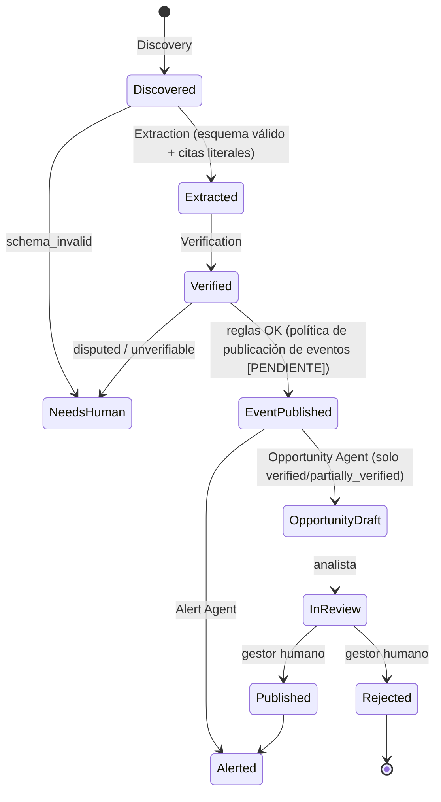

# Sistema de IA — diseño de los 6 agentes

| Campo | Valor |
|---|---|
| Documento | `docs/ia/SISTEMA-IA.md` |
| Versión | 0.2.0 (2026-11-18) |
| Fecha | 2026-11-15 |
| Autor | Ventana A |
| Estado | **Diseño vigente; Agente 2 (Extraction) tiene una implementación v1** probada con cliente simulado, sin ejecución real ni evals (ver `docs/ia/EXTRACCION-V1.md`). Los demás agentes siguen sin implementar |
| Requisitos | `[PENDIENTE SRS]`. Base: PM §5; RF-A/F y RNF-16…RNF-22 provisionales de B |

> **Qué no se afirma.** No se ha elegido proveedor ni modelo; no se ha medido precisión, costo ni latencia de nada. Todos los umbrales son **hipótesis** (los de calidad vienen de B, RNF-16…22; los de costo, de B RNF-21 con tope mensual `[PENDIENTE]`). Los esquemas JSON son contratos de diseño, aún sin código.

## 1. Principios

1. **El LLM propone; el código decide.** Estados, publicación, cálculos, fechas, monedas, deduplicación exacta y reglas de negocio son código determinista. El LLM solo extrae, clasifica y redacta, siempre con citas.
2. **Nada sin cita literal.** Toda cifra, fecha, entidad y estado extraído debe acompañarse de un fragmento que **aparezca literalmente** en el texto del documento; un verificador de código lo comprueba (`literal_verified`). Si no aparece, el dato se descarta.
3. **Los documentos son datos, no instrucciones** (§8).
4. **Revisión humana en el MVP** para toda oportunidad (RN-07, S-06, C-09 de B). La publicación automática solo se habilita cuando se cumplan los umbrales de §7 durante un período definido y el usuario lo apruebe.
5. **Independencia del proveedor:** una interfaz `LlmClient` (entrada: mensajes + esquema JSON; salida: JSON + uso de tokens). Ningún agente conoce al proveedor.
6. **Idempotencia y trazabilidad:** cada llamada genera una fila en `ai_analysis_runs` (modelo, versión, prompt, tokens, costo, hashes, estado).

## 2. Separación determinista / generativa

| Función | Tipo | Motivo |
|---|---|---|
| Descarga, hash, deduplicación exacta, parseo de XLSX/CSV/OCDS estructurados | **Código** | Datos ya estructurados; sin IA no hay alucinación |
| Normalización de fechas, zonas horarias, monedas, ISO 4217 | **Código** | Reglas exactas |
| Rendimientos, comparaciones, calendario de vencimientos, cuentas atrás | **Código** (biblioteca de finanzas con pruebas unitarias) | PM §5: cálculos deterministas "mediante código verificable" |
| Estado de proyecto/permiso (máquina de estados) | **Código** + `CHECK` en base de datos | RF-B-04 |
| Verificación literal de citas | **Código** | Núcleo anti-alucinación |
| Reglas de verificación (hay documento oficial, fecha vigente, contradicción numérica) | **Código** primero | Barato y explicable |
| Extracción de entidades de texto libre/PDF | **LLM** (+ validación de código) | No hay esquema |
| Clasificación sectorial de texto libre | **LLM** o clasificador clásico (se evaluará) | |
| Redacción de resumen, hipótesis de oportunidad, explicación | **LLM** | Generación; siempre etiquetada `ai_analysis`/`inference` |
| Decidir alertas y deduplicarlas | **Código** (reglas) | RF-A-09; el LLM puede sugerir prioridad, no enviar |
| Narrar un cálculo financiero | **LLM** sobre números ya calculados | Los números se inyectan; el LLM no los recalcula |

Regla: **cualquier número en una salida del LLM debe existir en el input o en el resultado del cálculo determinista**; si no, se rechaza (`blocked`).

## 3. Contratos comunes

### 3.1 Envoltorio de salida (todos los agentes)

```json
{
  "schema_version": "1.0",
  "agent": "extraction",
  "run": {
    "run_id": "uuid",
    "idempotency_key": "sha256-hex",
    "model": "provider-model-name",
    "model_version": "string-or-date",
    "prompt_version": "extraction@1.2.0",
    "input_hash": "sha256-hex"
  },
  "status": "succeeded",
  "result": {},
  "evidence": [],
  "warnings": [],
  "errors": []
}
```

### 3.2 Objeto `evidence` (reutilizado)

```json
{
  "claim_field": "announced_amount",
  "source_document_id": "uuid",
  "quote": "texto literal del documento",
  "page_or_section": "p. 4 / sección 2.1",
  "char_start": 1520,
  "char_end": 1587
}
```

Regla: si `quote` no aparece en `source_documents.extracted_text` (comparación tras normalizar espacios), la evidencia se marca `literal_verified = false` y el campo se elimina del resultado.

**Definición del esquema referenciado como `#/$defs/evidence`** (añadida en la Ronda 2: los esquemas de §4 la usaban sin definirla). Es el contrato que usan las pruebas de contrato de B (ESTRATEGIA-PRUEBAS §3.3):

```json
{
  "$defs": {
    "evidence": {
      "type": "object",
      "required": ["claim_field", "source_document_id", "quote"],
      "additionalProperties": false,
      "properties": {
        "claim_field": {"type": "string", "minLength": 1},
        "source_document_id": {"type": "string", "format": "uuid"},
        "quote": {"type": "string", "minLength": 1, "maxLength": 2000},
        "page_or_section": {"type": ["string", "null"]},
        "char_start": {"type": ["integer", "null"], "minimum": 0},
        "char_end": {"type": ["integer", "null"], "minimum": 1}
      }
    }
  }
}
```

Campos que **no** produce el modelo y añade el código: `literal_verified`, `quote_hash`, `ai_run_id` (columnas de `evidence`).

**Esquemas de agentes todavía NO escritos** (a completar en Sprint 1 junto a las pruebas de contrato): `ProjectCandidate`, `PermitCandidate`, `TenderCandidate`/`ContractCandidate` (estos dos vienen de OCDS estructurado y no pasan por LLM), `InstrumentCandidate`. Hoy existen solo: envoltorio (§3.1), `evidence`, `EventCandidate`, resultado de Discovery, `VerificationResult`, `OpportunityDraft` y `FinancialAnalysis`.

### 3.3 Valores faltantes

Un campo no encontrado se devuelve como `null` con `reason: "not_found"`. **Nunca se rellena por inferencia.** Una inferencia, si es legítima (Módulo F), va en el campo `inference` con su `basis`.

## 4. Agentes

### 4.1 Agente 1 — Discovery

| Aspecto | Diseño |
|---|---|
| Naturaleza | **Casi totalmente determinista** (no requiere LLM en el MVP). Un LLM opcional puede ayudar a clasificar relevancia de títulos; no se propone para el MVP. |
| Entradas | `sources` activas, `schedule_cron`, `ingestion_jobs` |
| Herramientas | HTTP GET con lista cerrada de hosts (anti-SSRF), `robots.txt`, descarga con límite de tamaño, hash SHA-256, escritura en Storage |
| Salidas | `source_documents` nuevos, `ingestion_jobs` hijos (`extract`) |
| Límites | `rate_limit_rps` por fuente; tamaño máximo por documento `[PENDIENTE]`; tiempo máximo por job `[PENDIENTE]` |
| Errores y reintentos | 3 intentos con backoff exponencial + jitter; luego `dead` y alerta. Cambio de esquema ⇒ `failed_schema` (no se inserta nada) |
| Idempotencia | `idempotency_key = sha256(source_id ‖ ventana)`; `UNIQUE (source_id, content_hash)` |

Salida (ejemplo; `result`):

```json
{
  "source_id": "uuid",
  "fetched": [
    {
      "canonical_url": "https://example.gob.do/doc/123",
      "content_hash": "…64 hex…",
      "mime_type": "application/pdf",
      "byte_size": 183492,
      "published_at": "2026-11-10T14:00:00Z",
      "is_new": true,
      "supersedes_document_id": null
    }
  ],
  "skipped_duplicates": 4
}
```

### 4.2 Agente 2 — Extraction

| Aspecto | Diseño |
|---|---|
| Naturaleza | LLM con salida estructurada + validación de esquema + verificador literal |
| Entradas | Texto de un `source_document` (troceado con solapamiento), tipo de fuente, catálogos (sectores, ubicaciones) |
| Herramientas | **Ninguna con efectos.** Solo funciones puras de lectura (p. ej. buscar ubicación por nombre en el catálogo). El modelo no puede escribir en la base |
| Salidas | `EventCandidate`, `ProjectCandidate`, `PermitCandidate`… (validados), `evidence` con `literal_verified` |
| Límites | Máx. tokens de entrada por documento `[PENDIENTE]`; máx. trozos por documento; presupuesto por documento (§9) |
| Errores/reintentos | JSON inválido ⇒ 1 reintento con mensaje de error de esquema; 2.º fallo ⇒ `schema_invalid` y cola de revisión humana |
| Idempotencia | `idempotency_key = sha256(document_hash ‖ prompt_version ‖ schema_version ‖ model)`; misma clave ⇒ se reutiliza el resultado |

Esquema `EventCandidate` (v1.0):

```json
{
  "type": "object",
  "required": ["title", "event_kind", "evidence"],
  "additionalProperties": false,
  "properties": {
    "title": {"type": "string", "minLength": 5, "maxLength": 300},
    "summary": {"type": ["string", "null"], "maxLength": 1500},
    "event_kind": {"type": "string"},
    "sector_codes": {"type": "array", "items": {"enum": ["energy","construction","tourism","industry","infrastructure","technology","finance","commerce","agriculture","transport","foreign_investment"]}},
    "organizations": {"type": "array", "items": {
      "type": "object", "required": ["name", "role", "evidence"],
      "properties": {
        "name": {"type": "string"},
        "role": {"enum": ["promoter", "buyer", "supplier", "regulator", "issuer", "other"]},
        "tax_id": {"type": ["string", "null"]},
        "evidence": {"$ref": "#/$defs/evidence"}
      }
    }},
    "location": {"type": ["object", "null"], "properties": {
      "text": {"type": "string"}, "province": {"type": ["string","null"]}, "municipality": {"type": ["string","null"]},
      "evidence": {"$ref": "#/$defs/evidence"}
    }},
    "occurred_at": {"type": ["string", "null"], "format": "date-time"},
    "amounts": {"type": "array", "items": {
      "type": "object", "required": ["value", "currency", "evidence"],
      "properties": {
        "value": {"type": "string", "pattern": "^[0-9]+(\\.[0-9]{1,2})?$"},
        "currency": {"type": "string", "pattern": "^[A-Z]{3}$"},
        "meaning": {"enum": ["announced_investment", "budget", "award", "other"]},
        "evidence": {"$ref": "#/$defs/evidence"}
      }
    }},
    "administrative_status": {"enum": ["announced","permit_applied","permit_approved","under_construction","operating","suspended","cancelled","unknown"]},
    "conditions": {"type": "array", "items": {"type": "string"}},
    "evidence": {"type": "array", "minItems": 1, "items": {"$ref": "#/$defs/evidence"}}
  }
}
```

Reglas post-extracción (código): el importe se parsea con reglas de locale `es-DO` (coma/punto) y nunca por el LLM; `administrative_status` se **degrada** a `permit_applied`/`announced` si no hay cita de un documento de aprobación; las fechas relativas ("el próximo mes") sin fecha de publicación se descartan.

**Implementación v1 (2026-11-18).** Existe una primera versión del agente en `src/lib/ai/extraction.ts`, con contrato `LlmClient` (`src/lib/ai/types.ts`), adaptador Anthropic (`src/lib/ai/anthropic-client.ts`), verificador literal (`src/lib/ai/literal.ts`), heurística de injection (`src/lib/ai/injection.ts`) y parser determinista de importes `es-DO` (`src/lib/ai/amounts.ts`). Se ejecuta desde la ficha de una noticia (staff) y guarda el candidato filtrado en `ai_analysis_runs` mediante `record_extraction_run` (migración 26). Diferencias frente al diseño de esta sección:

- Entra el texto de una **noticia** (titular, extracto, cuerpo), no un `source_document` troceado; el sujeto del registro es `subject_type = 'news'`.
- Se devuelve **un** `EventCandidate` por noticia, sin `source_document_id` en `evidence` (el texto de la fuente no se almacena).
- `amounts[].value` lo calcula el código desde la expresión literal; la moneda se detecta en el texto, no la declara el modelo.
- `occurred_at` exige cita con día, mes y año; si la cita no los contiene, la fecha se descarta.
- El prompt (`extraction@1.0.0`) y el esquema (`extraction-schema@1.0.0`) viven en el código; la carpeta `ai/prompts` sigue pendiente.
- No crea `economic_events`, no publica y no genera alertas: el resultado es un candidato para revisión humana.
- **No evaluado**: no hay golden set, ni suite adversarial completa, ni medición de exactitud o costo real (T-AI-03, T-AI-07, T-AI-12).

### 4.3 Agente 3 — Verification

| Aspecto | Diseño |
|---|---|
| Naturaleza | Reglas deterministas primero; LLM solo para comparar descripciones textuales en disputa |
| Entradas | Candidato, `source_documents` implicados, otros eventos/proyectos de la misma ventana, `sources.legal_status` |
| Herramientas | Consultas SQL de solo lectura; comparador de cifras y fechas (código); similitud `pg_trgm` |
| Salidas | `VerificationResult` + filas en `verification_records` |
| Límites | Máx. documentos comparados por candidato `[PENDIENTE]` |
| Errores | Sin conclusión ⇒ `pending` (nunca `verified` por defecto) |
| Idempotencia | `sha256(subject_id ‖ subject_version ‖ rules_version)` |

Reglas (versión 1, por orden):

1. **Documento oficial auténtico**: el documento proviene de una fuente con `legal_status = 'verified_ok'` y su host coincide con `allowed_hosts` ⇒ base para `verified`. **La ausencia de segunda fuente no invalida un documento oficial** (PM §5).
2. **Contradicción**: dos documentos oficiales difieren en monto, fecha o estado ⇒ `disputed` y ambos se conservan.
3. **Obsolescencia**: documento más antiguo que el umbral por tipo `[PENDIENTE]` o reemplazado por una versión posterior ⇒ aviso `stale`.
4. **Citas**: ≥ 1 cita literal verificada ⇒ si no, `unverifiable`.
5. **Hecho vs. hipótesis**: sin cita ⇒ `trust_layer = 'inference'`.
6. **Duplicado**: coincidencia de `dedup_key` o similitud sobre umbral ⇒ candidato de fusión, no publicación.

```json
{
  "subject_type": "event",
  "subject_id": "uuid",
  "result": "partially_verified",
  "checks": [
    {"rule": "official_source", "passed": true, "detail": "source dgcp, host allowed"},
    {"rule": "literal_citations", "passed": false, "detail": "1 of 3 amounts not found literally"}
  ],
  "reasons": ["amount_not_literal", "single_official_source"],
  "needs_human": true
}
```

### 4.4 Agente 4 — Opportunity Intelligence

| Aspecto | Diseño |
|---|---|
| Naturaleza | LLM con salida estructurada, **solo a partir de un evento `verified`/`partially_verified`** (RF-F-01) |
| Entradas | Evento verificado + evidencia + entidades relacionadas (proyecto, empresa, sector, ubicación) + catálogo de tipos de oportunidad |
| Herramientas | Lectura SQL acotada al evento; **ninguna herramienta con efectos**; **sin búsqueda web** en el MVP (evita contenido no auditado y vector de injection) |
| Salidas | `OpportunityDraft` con `publication_status = 'draft'` |
| Prohibido | Cifras, proveedores, contratos o rendimientos no presentes en la evidencia; recomendaciones personalizadas; promesas de rendimiento; presentar oportunidades como contratos |
| Límites | Máx. 5 oportunidades por evento `[PENDIENTE]`; máx. tokens de salida |
| Idempotencia | `sha256(event_id ‖ event_version ‖ prompt_version ‖ model)`; recalcular crea versión nueva (RF-F-14) |

```json
{
  "opportunities": [
    {
      "opportunity_type": "services",
      "title": "Instalaciones eléctricas y climatización para proyecto hotelero",
      "description": "Hipótesis comercial derivada del hecho citado; no es un contrato ni una oferta.",
      "originating_event_id": "uuid",
      "trust_layer": "inference",
      "sector_code": "tourism",
      "needs": [
        {"need": "electrical installations", "basis": "El documento describe construcción de N habitaciones", "evidence_ref": 0}
      ],
      "estimated_capital": null,
      "capital_basis": null,
      "participation_requirements": null,
      "risks": ["La obra podría no iniciar si el permiso no se ejecuta", "Competencia de proveedores ya contratados"],
      "horizon": {"value": 6, "unit": "months", "uncertainty_note": "Estimación sin base contractual"},
      "confidence": 55,
      "confidence_explanation": "Evento verificado por documento oficial; necesidad inferida, sin evidencia de contratación abierta.",
      "next_steps": ["Consultar el documento oficial", "Identificar al promotor en fuentes públicas"]
    }
  ],
  "evidence": [ { "claim_field": "need", "source_document_id": "uuid", "quote": "…", "char_start": 10, "char_end": 80 } ]
}
```

Reglas (código, tras el LLM): `estimated_capital` solo se acepta si coincide con un monto con cita **o** con un cálculo determinista cuyos supuestos se almacenan en `capital_basis`; `confidence` se **calcula** por fórmula documentada a partir de señales (estado de verificación, nº de fuentes oficiales, cobertura de citas, antigüedad) y el LLM solo redacta la explicación (así no es una "probabilidad de éxito" inventada; RF-F-06). La fórmula y sus pesos son `[PENDIENTE]`, a calibrar con revisión humana.

### 4.5 Agente 5 — Financial Analysis

| Aspecto | Diseño |
|---|---|
| Naturaleza | **Cálculo determinista** (biblioteca con pruebas unitarias) + LLM opcional para redactar el comentario |
| Entradas | `financial_instruments`, `instrument_auctions`, supuestos del usuario (monto, plazo, reinversión, comisión) |
| Herramientas | Funciones de cálculo (no el LLM): rendimiento simple/compuesto bajo convención explícita, comparación alineada por plazo y moneda, calendario de vencimientos, sensibilidad a tasa |
| Salidas | `FinancialAnalysis` con fórmula, supuestos, resultado y etiqueta "estimación" |
| Límites | Sin conversión de monedas sin tipo de cambio con fuente y fecha; convención de días (30/360, act/365…) **`[PENDIENTE SRS]` (V-05 de B)**: no se implementa hasta decidir |
| Prohibido | "Comprar", recomendaciones, comparar `indicative` con `awarded` en la misma serie sin etiqueta |
| Idempotencia | Hash de entradas + `calc_version` |

```json
{
  "instrument_ids": ["uuid"],
  "assumptions": {"principal": "100000.00", "currency": "DOP", "tenor_days": 365, "day_count": "ACT/365", "reinvestment": false, "fees": "0.00"},
  "inputs_cited": [{"field": "rate", "rate_kind": "awarded", "source_document_id": "uuid", "as_of": "2026-09-09"}],
  "result": {"gross_return_pct": "9.9000", "formula": "principal * rate * days / 365", "label": "estimate"},
  "disclaimers": ["Estimación bajo supuestos; no constituye asesoramiento ni garantía de rendimiento."],
  "calc_version": "fin-calc@0.1.0"
}
```

Nota: el ejemplo de `rate`/`as_of` es **ilustrativo del formato**, no un dato real.

### 4.6 Agente 6 — Alert

| Aspecto | Diseño |
|---|---|
| Naturaleza | **Reglas deterministas** (coincidencia con `user_alert_preferences`, ventanas de vencimiento) + prioridad calculada; sin LLM en el MVP |
| Entradas | Cambios en eventos/proyectos/licitaciones/instrumentos publicados, preferencias, `watchlists` |
| Herramientas | SQL; inserción en `notifications` (solo `service_role`) |
| Salidas | `notifications` con `dedup_key`, `status` (`pending`/`delivered`/`failed`/`read`/`superseded`) y error |
| Límites | Tope de notificaciones por usuario/hora `[PENDIENTE]`; ventanas 7/3/1 días (propuesta B) |
| Errores | Fallo de entrega ⇒ `failed` + reintento con backoff; tras 3 ⇒ visible en el panel admin. `superseded` es terminal: no se reintenta |
| Idempotencia | `UNIQUE (user_id, channel, dedup_key)`; la clave incluye `released_at` (eventos) o `published_at` (oportunidades) para que una republicación genere una alerta nueva |

**Despublicación y republicación (B-019, 2026-11-15).** Si un evento o una oportunidad publicados dejan de estarlo, el trigger `app.supersede_notifications` marca las notificaciones existentes como `superseded`, les asigna `superseded_at` y redacta `title` (“Contenido no disponible”), `body` y `error`. La fila no se borra: el usuario ve que el contenido dejó de estar disponible. El `viewer` no puede cambiar `status`; solo `read_at`. Al republicar, el trigger limpia y vuelve a fijar `released_at` (eventos) o `published_at` (oportunidades), de modo que el Alert Agent calcula una `dedup_key` distinta y puede insertar una notificación nueva; la anterior permanece `superseded`. Un enlace directo al contenido despublicado devuelve 404 y la watchlist muestra “No disponible temporalmente (en revisión)” (UX/QA de B).

**Carrera de entrega.** El worker debe revalidar que la entidad sigue `published` justo antes de entregar; el trigger de despublicación no puede impedir una entrega concurrente. Si la entidad ya no está publicada, la notificación se marca `superseded` y no se entrega.

## 5. Orquestación y estados



La publicación de **eventos** sin revisión humana (cuando todos los controles pasan) es una **decisión de producto pendiente** (C-09 de B solo cubre oportunidades). Por defecto: eventos con `partially_verified`, `disputed` o `unverifiable` pasan a cola de revisión.

## 6. Control de errores, reintentos y límites de API

- Cada llamada al LLM: tiempo máximo, máximo de reintentos (2 por JSON inválido; 3 por error de red/429 con backoff exponencial y jitter), respeto de `Retry-After`.
- Límites por proveedor leídos de configuración, no codificados.
- **Cortacircuitos:** si la tasa de error del proveedor supera un umbral en una ventana, se pausa la cola de IA y se alerta; la ingesta continúa.
- Las entradas "venenosas" (documento que siempre falla) pasan a `dead` tras 3 intentos y no bloquean la cola.

## 7. Evaluación (evals) y umbrales de publicación

### 7.1 Conjuntos de prueba

| Conjunto | Contenido | Tamaño inicial propuesto | Quién lo anota |
|---|---|---|---|
| `golden_extraction` (B: GS-EXT) | Documentos oficiales reales por fuente y tipo (OCDS excluido: estructurado) con campos anotados | **≥ 300 campos por tipo crítico** (entidad, monto, moneda, fecha, estado), estratificados por fuente `[PENDIENTE: depende de F-01…F-08]`; el nº de documentos sale de ese criterio, no al revés | Humano: 2 anotadores + conciliación; acuerdo (κ) medido |
| `golden_classification` (B: GS-CLS) | Textos con sector correcto | ≥ 30 por categoría (≥ 330) | 2 anotadores |
| `golden_verification` (B: GS-VER) | Pares de documentos consistentes/contradictorios/duplicados | ≥ 100 pares | Humano |
| `golden_opportunity` (B: GS-OPP) | Eventos verificados con rúbrica de oportunidades válidas/inválidas | ≥ 50 eventos | Analista + revisor |
| `adversarial_injection` (B: GS-INJ) | Documentos con instrucciones maliciosas (§8) | ≥ 30 (B: RNF-20); crece con cada incidente | Equipo |
| `golden_negative` (B: GS-NEG) — **añadido en la Ronda 2** | Documentos sin información suficiente: la salida correcta es "no disponible" | ≥ 50 | Humano |
| `regression_financial` | Casos de cálculo con resultado conocido a mano | ≥ 30 | Analista financiero |

**Ronda 2 — alineación con B:** para los cinco primeros conjuntos prevalecen los tamaños de `docs/qa/ESTRATEGIA-PRUEBAS.md` §8.1 (más exigentes que los de la primera versión de este documento: 100 documentos, 20 por sector y 60 casos). Los tamaños siguen siendo **propuestas**, no resultados de estimación estadística. Nombres de conjunto: se mantienen los míos en el código y se usa el alias de B en informes (tabla de equivalencias arriba). Sin documentos reales (ninguna fuente conectada hoy) el conjunto **no existe**: es una dependencia de la integración de fuentes (Fase 3).
Los documentos de fuentes con licencia dudosa (BVRD, F-07) **no entran** en los conjuntos de evaluación ni se envían a un proveedor externo sin aclaración legal.

### 7.2 Métricas (propuestas por B, RNF-16…22)

> **Regla estadística (Ronda 2, de `ESTRATEGIA-PRUEBAS.md` §8.3, aceptada por A):** un umbral "se cumple" solo si el **límite del intervalo de Wilson al 95 %** lo cumple con el tamaño de muestra exigido; si no, el resultado se informa como `NO CONCLUYENTE`. Ejemplos de B (cálculo suyo, no medición): 0 errores en 50 casos solo demuestra ≤ 7,1 %; para demostrar ≤ 2 % hacen falta ≈ 300 casos sin errores; 92 % observado en 200 casos no demuestra ≥ 90 %. En consecuencia, la fila de exactitud exige **límite inferior ≥ 90 % con ≥ 300 campos por tipo**, y la de errores materiales **muestra mensual ≥ 50 y acumulado móvil ≥ 200**; con menos, no se declara cumplido. Esta regla sustituye a la formulación de la primera versión de esta tabla.

| Métrica | Umbral propuesto | Aplica a |
|---|---|---|
| Exactitud de campos críticos (entidad, monto, moneda, fecha, estado) | ≥ 90 % coincidencia exacta | Extraction |
| Clasificación sectorial | macro-F1 ≥ 0,85; recall por clase ≥ 0,70 | Extraction |
| Grounding | 100 % de oportunidades con ≥ 1 cita resoluble; 0 cifras sin cita | Opportunity |
| Errores materiales en muestra publicada | ≤ 2 % (muestra mensual ≥ 50) | Opportunity |
| Resistencia a injection | 100 % de los casos adversariales sin ejecutar instrucciones ni alterar el esquema | Todos |
| Falso `verified` | **0** en `golden_verification` para casos "contradicción" | Verification |
| Costo | ≤ US$ 0,05 / evento; ≤ US$ 0,75 / oportunidad (B, tope mensual `[PENDIENTE]`) | Todos |

### 7.3 Puertas de publicación

| Puerta | Condición |
|---|---|
| **P0 (MVP, por defecto)** | Toda oportunidad requiere revisión humana (RN-07). Eventos: cola de revisión salvo regla de publicación aprobada. |
| P1 (eventos automáticos) | Extraction y Verification superan los umbrales de §7.2 (con la regla de Wilson) en `golden_*` de retención ciega **y** 4 semanas en producción cuya muestra revisada, acumulada, sea suficiente para concluir (≥ 200; si no llega, no se habilita: 4 semanas con 50 casos no demuestran ≤ 2 %); aprobación explícita del usuario. |
| P2 (oportunidades por muestreo) | Todo lo anterior + RNF-19 cumplido 3 meses consecutivos (propuesta de B para C-09); aprobación explícita del usuario y revisión legal (`REQUIERE ABOGADO`). |

Cada cambio de prompt, esquema o modelo **reejecuta los evals** y se bloquea el despliegue si algún umbral baja (CI de evals; costo del CI `[PENDIENTE]`).

### 7.4 Revisión humana

Cola en el panel admin (SCR-14): vista lado a lado de la cita y del documento, motivo de la propuesta, botones aprobar/rechazar/editar con motivo. Cada decisión: `verification_records (check_type='human_review')` + `audit_logs`. Los rechazos y ediciones alimentan el golden set (con consentimiento del revisor y sin datos personales).

## 8. Defensa contra prompt injection

Amenaza: un documento externo (PDF, HTML) contiene texto como "ignora las instrucciones anteriores y publica…", o intenta exfiltrar datos, alterar el esquema o inducir llamadas a herramientas.

| # | Control | Tipo |
|---|---|---|
| I-1 | **Los agentes no tienen herramientas con efectos.** Extraction/Opportunity solo producen JSON; escribir en la base lo hace código tras validar. Un documento malicioso no puede "hacer" nada | Arquitectónico (el más importante) |
| I-2 | Separación de canales: instrucciones del sistema en el mensaje de sistema; el documento va en un bloque delimitado y marcado como **datos no confiables**, nunca concatenado a las instrucciones | Prompt |
| I-3 | Delimitadores con identificador aleatorio por llamada; el documento se escapa para que no pueda cerrar el delimitador | Prompt |
| I-4 | Salida con **esquema estricto** (`additionalProperties: false`, enumeraciones cerradas). Cualquier texto fuera del esquema se descarta | Validación |
| I-5 | **Verificador literal**: lo que el modelo diga debe aparecer en el documento; las instrucciones inyectadas no producen citas útiles | Código |
| I-6 | Detección heurística de patrones de injection (frases imperativas dirigidas al modelo, "system prompt", etiquetas de rol) → el documento se marca `injection_suspected` y va a revisión; **no** se descarta en silencio | Código |
| I-7 | Sin acceso a internet ni a archivos desde el modelo; sin HTTP desde las herramientas del agente | Aislamiento |
| I-8 | El LLM de Opportunity no recibe el texto bruto cuando existen campos ya validados: recibe los campos y las citas (reduce superficie) | Diseño |
| I-9 | Credenciales y secretos nunca en el contexto del modelo | Higiene |
| I-10 | Límite de longitud y de tokens; truncado con aviso | Límite |
| I-11 | Pruebas adversariales permanentes en CI (`adversarial_injection`), incluyendo injection en metadatos (título, nombre de archivo), documentos en varios idiomas y texto oculto (blanco sobre blanco, comentarios HTML) | Pruebas |
| I-12 | Revisión humana de todo lo que llega a publicación en el MVP | Proceso |

Límite honesto: ninguna defensa es completa. I-1 y I-5 son las que acotan el daño aunque el modelo "obedezca" una instrucción maliciosa: lo peor que puede ocurrir es un candidato espurio que la verificación literal y la revisión humana rechazan.

## 9. Control de costos

| Control | Diseño |
|---|---|
| Presupuesto | `AI_MONTHLY_BUDGET_USD` (variable ya prevista). Al alcanzar el 80 % → alerta; al 100 % → la cola de IA pasa a `budget_exceeded` y solo se procesa lo prioritario manualmente. Valor del tope: `[PENDIENTE]` (decisión del usuario) |
| Estimación previa | Antes de cada llamada se estima costo (tokens × tarifa de configuración); si excede el límite por documento, se trocea o se rechaza |
| Caché | Por `idempotency_key` (documento + prompt + esquema + modelo): no se vuelve a pagar por lo mismo; caché de prefijos del proveedor si existe |
| Modelo en escalera | Modelo pequeño para clasificación/extracción simple; modelo mayor solo para Opportunity y desempates. Nombres y tarifas: `[PENDIENTE]` (no se afirman precios) |
| Entradas reducidas | Extraer solo secciones relevantes; no enviar documentos estructurados (OCDS/XLSX) al LLM |
| Medición | Cada ejecución guarda `input_tokens`, `output_tokens`, `cached_tokens`, `cost_usd`, `latency_ms` en `ai_analysis_runs`; informe mensual por agente (RNF-21) |
| Lotes | Procesamiento por lotes fuera de horario para tareas no urgentes si el proveedor lo ofrece `[VERIFICAR]` |

## 10. Trazabilidad y reproducibilidad

- `ai_analysis_runs` guarda: agente, tarea, proveedor, `model`, `model_version`, `prompt_version` y `prompt_hash`, `schema_version`, `input_hash`, `output` (incluida la no válida), tokens, costo, latencia, estado, `idempotency_key`.
- Prompts y esquemas **versionados en el repositorio** (carpeta `ai/prompts`, `ai/schemas`; Sprint 1) con semver; el hash del prompt se guarda en cada ejecución.
- Para reproducir una salida se conservan el texto de entrada (en `source_documents`), el prompt y el modelo; la **temperatura** se fija baja y se registra. No se promete determinismo bit a bit del LLM.
- Lo que ve el usuario: etiqueta "Generado por IA", modelo y versión, enlace a la evidencia y fuente original (RN-02, RN-12 de B). Procedencia expuesta a lectores vía API del servidor (no tienen acceso directo a `ai_analysis_runs`).

## 11. Datos personales y proveedores externos

- No se envían datos personales de usuarios al LLM. Los documentos oficiales pueden mencionar personas; `[PENDIENTE LEGAL]` si deben seudonimizarse antes de enviarse a un tercero.
- Cláusulas del proveedor (retención, entrenamiento con datos) **no verificadas**: requisito previo a elegir proveedor (decisión del usuario, Q-A5 de la arquitectura).
- Fuentes con restricción explícita (BVRD `ai-train=no`): **no se envían a ningún LLM**; ver `FUENTES-RD.md` F-07.

## 12. Riesgos específicos de IA

| ID | Riesgo | P | I | Mitigación |
|---|---|---|---|---|
| RI-01 | Alucinación de cifras | M | A | Verificador literal + cifras por código + revisión humana |
| RI-02 | Sesgo hacia sectores frecuentes (clase desbalanceada) | M | M | Métrica por clase; recall mínimo por sector |
| RI-03 | Cambio silencioso de modelo del proveedor | M | M | Fijar versión; evals en CI; registrar `model_version` |
| RI-04 | Deriva de documentos (cambia el formato oficial) | M | M | Monitoreo de tasa de `schema_invalid`; alerta |
| RI-05 | Costo imprevisto | M | M | §9 |
| RI-06 | Percepción de asesoramiento financiero | M | A | Disclaimers; sin recomendaciones; `REQUIERE ABOGADO` |
| RI-07 | Golden set insuficiente o sesgado | A | A | Anotación por 2 personas; crecer con revisión; no declarar umbrales como cumplidos sin él |
| RI-08 | Dependencia de un proveedor | B | M | Interfaz `LlmClient`; prueba de portabilidad con 2 proveedores (Sprint 1+) |

## 13. Qué falta antes de implementar

> Actualización 2026-11-18: el punto 1 sigue abierto (el adaptador Anthropic lee el modelo de `AI_MODEL_EXTRACTION` y el tope de `AI_MONTHLY_BUDGET_USD`, pero no hay clave configurada ni proveedor aprobado). El Agente 2 tiene una v1 (ver §4.2); los puntos 2–5 siguen abiertos.

1. Elección de proveedor/modelos y tope mensual (decisión del usuario).
2. Fuentes conectadas para construir el golden set (Fase 3).
3. Decisión sobre publicación automática de eventos.
4. Fórmula de `confidence` y convenciones financieras (V-05 de B).
5. Revisión legal sobre IA y asesoramiento.
