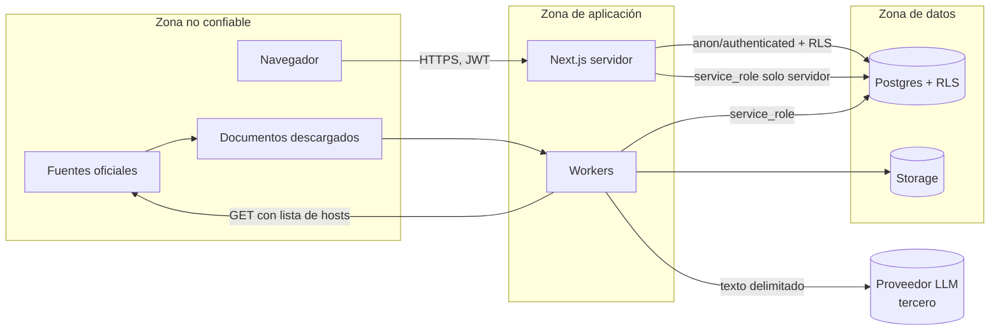

# Seguridad y cumplimiento — AviTech Investment Intelligence

| Campo | Valor |
|---|---|
| Documento | `docs/seguridad/SEGURIDAD-Y-CUMPLIMIENTO.md` |
| Versión | 0.1.0 (Sprint 0) |
| Fecha | 2026-11-15 |
| Autor | Ventana A |
| Estado | **PROPUESTA**. Ningún control está implementado ni probado |
| Requisitos | `[PENDIENTE SRS]`. Base: PM §10 y RNF-23…RNF-28 provisionales de B |

> **Alcance y límites.** Este documento es un diseño técnico de seguridad. **No es asesoramiento legal.** En §7 las obligaciones legales aparecen como *áreas a consultar*; donde no puedo concluir, está marcado **`REQUIERE ABOGADO`**. Las leyes mencionadas se citan por nombre/número solo si aparecieron en una fuente consultada hoy; las demás llevan `NO VERIFICADO`.

## 1. Activos y fronteras de confianza

| Activo | Sensibilidad | Dónde |
|---|---|---|
| Cuentas y sesiones de usuario | Alta | Supabase Auth |
| Datos personales (correo, nombre, IP, preferencias) | Alta (personales) | `users`, `audit_logs`, `watchlists` |
| Claves: `SUPABASE_SERVICE_ROLE_KEY`, `AI_API_KEY`, `INGESTION_CRON_SECRET` | Crítica | Variables de entorno de servidor |
| Documentos originales y evidencia | Media (integridad crítica) | Storage, `source_documents` |
| Contenido publicado (eventos, oportunidades) | Integridad crítica: una cifra falsa daña a usuarios | Base de datos |
| Auditoría | Integridad crítica | `audit_logs` |
| Presupuesto de IA | Económica | Proveedor LLM |

Fronteras clave: (1) navegador↔servidor, (2) servidor↔fuentes externas (SSRF), (3) documentos externos↔LLM (injection), (4) workers↔base (credenciales privilegiadas), (5) nuestro sistema↔proveedor LLM (datos salen de nuestro control).

## 2. Modelo de amenazas (STRIDE)

P/I = probabilidad/impacto estimados **por juicio**, sin datos (A/M/B). "Control" referencia las secciones siguientes.

| ID | Categoría | Amenaza | P | I | Controles |
|---|---|---|---|---|---|
| T-01 | Spoofing | Robo de sesión o cuenta (phishing, reutilización de contraseña) | M | A | §3: verificación de correo, MFA para admin, sesiones cortas, rate limit de login |
| T-02 | Spoofing | Un atacante suplanta una fuente oficial (DNS/redirección) | B | A | Lista de hosts cerrada, HTTPS obligatorio, verificación de certificado, hash y comparación con versión previa, alerta de cambio brusco |
| T-03 | Tampering | Modificar estado de proyecto/permiso sin documento | M | A | `CHECK` en base (RF-B-04), RLS, auditoría |
| T-04 | Tampering | Alterar un documento original tras guardarlo | B | A | Trigger de inmutabilidad, hash, almacenamiento solo-escritura para workers, auditoría |
| T-05 | Tampering | **Prompt injection** en documentos para publicar contenido falso | M | A | `SISTEMA-IA.md` §8 (sin herramientas con efectos, esquema estricto, verificador literal, revisión humana) |
| T-06 | Tampering | Un worker o `service_role` comprometido publica oportunidades | B | A | Trigger: publicación exige usuario gestor autenticado; separación de claves por componente |
| T-07 | Repudiation | Un admin niega haber cambiado un rol/estado | M | M | `audit_logs` append-only con actor, antes/después, `request_id` |
| T-08 | Info disclosure | Fuga entre usuarios/organizaciones por RLS mal escrita | M | A | RLS por defecto-denegar, suite de pruebas por rol (RNF-24), `anon` sin acceso, revisión de políticas |
| T-09 | Info disclosure | `service_role` expuesto en el cliente o en el repo | B | **Crítico** | Solo servidor, `gitleaks` en CI, rotación, `.env.local` ignorado (verificar `.gitignore`) |
| T-10 | Info disclosure | Texto de documentos con licencia restringida expuesto a lectores | M | M | Sin `extracted_text` para `authenticated`; descarga solo si `redistribution_allowed` |
| T-11 | Info disclosure | Datos personales enviados al proveedor LLM | M | M | No enviar PII de usuarios; evaluar documentos con personas; cláusulas del proveedor |
| T-12 | DoS | Abuso de búsqueda o API (scraping, cargas pesadas) | A | M | Rate limiting por IP/usuario, paginación obligatoria, límites de consulta |
| T-13 | DoS | Bomba de documento (zip bomb, PDF gigante) en ingesta | M | M | Límite de tamaño y descompresión, tiempo máximo, procesamiento en streaming, worker aislado |
| T-14 | DoS | Agotar presupuesto de IA (documento enorme, bucle de reintentos) | M | M | Presupuesto duro, estimación previa, reintentos acotados |
| T-15 | Elevation | Escalada de rol (viewer→admin) por columna `role` | M | A | `role` no actualizable por `authenticated`; solo `app.set_user_role()` con comprobaciones |
| T-16 | Elevation | **SSRF** vía conectores (URL controlada por contenido externo, redirecciones a red interna) | M | A | §5: lista de hosts por fuente, bloqueo de IP privadas/metadata, sin seguir redirecciones a hosts no listados |
| T-17 | Elevation | Inyección SQL / XSS | M | A | Consultas parametrizadas (cliente Supabase/driver), sin SQL por concatenación, escape de salida en React, CSP, sanitizar HTML de fuentes |
| T-18 | Tampering | Dependencias comprometidas (cadena de suministro) | M | A | Lockfile, `npm audit`, revisión de dependencias, fijar versiones, no instalar sin aprobación (Regla 5 PM) |
| T-19 | Info disclosure | Logs con datos sensibles | M | M | Logs estructurados sin PII ni secretos; redacción |
| T-20 | Repudiation | Falta de prueba de qué versión de la fuente se usó | M | M | `content_hash`, `terms_version`, `fetched_at` por documento |
| T-21 | Legal | Acceso automatizado contra términos de la fuente | A | A | `sources.legal_status` + `CHECK`: no se activa conector sin verificación; ver FUENTES-RD |

## 3. Autenticación y autorización

| Tema | Diseño propuesto | Estado |
|---|---|---|
| AuthN | Supabase Auth (correo+contraseña; magic link opcional). Verificación de correo obligatoria (RF-G-01). Política de contraseñas y bloqueo por intentos: `[VERIFICAR Sprint 1 qué ofrece Supabase]` | Propuesta |
| MFA | Obligatoria para `org_admin` y `platform_admin`; opcional para el resto | Propuesta `[VERIFICAR soporte]` |
| Sesiones | JWT de vida corta + refresh; cookies `HttpOnly`, `Secure`, `SameSite=Lax` (con `@supabase/ssr`) | `[VERIFICAR Sprint 1 con docs de Next 16 y @supabase/ssr]` |
| AuthZ | **Tres capas**: (1) middleware/ruta rechaza no autenticados; (2) comprobación de rol en servidor antes de acciones sensibles; (3) **RLS** como red final (`MODELO-DATOS.md` §7). Ninguna decisión de seguridad solo en el cliente | Propuesta |
| Roles | `viewer`, `analyst`, `opportunity_manager`, `org_admin`, `platform_admin`; mínimo privilegio; cambio de rol solo por `app.set_user_role()` y auditado | Propuesta (B: RF-G-02) |
| Admin | Rutas `/admin/**` exigen rol en servidor y devuelven 403 (AC-MVP-10 de B) | Propuesta |
| Cuentas de servicio | Una clave por componente (web, worker de ingesta, worker de IA, cron), con rotación documentada; el navegador **nunca** recibe `service_role` | Propuesta |

Nota Next.js 16: las convenciones (proxy/middleware, Server Actions, caché) pueden diferir de versiones anteriores (`AGENTS.md`). **No** se asume ninguna API; se leerá `node_modules/next/dist/docs/` antes de implementar los controles de §3 y §4.

## 4. Validación de entradas y protección de endpoints

- **Validación con `zod`** (ya es dependencia) en el borde de cada Route Handler/Server Action: tipos, longitudes, enumeraciones cerradas, tamaño de cuerpo. Rechazo por defecto de campos desconocidos.
- **Paginación y límites** obligatorios: tamaño máximo de página; `LIMIT` en toda consulta de lista; filtros de texto con longitud máxima.
- **Salida:** React escapa por defecto; prohibido `dangerouslySetInnerHTML` con contenido de fuentes; si se necesita HTML enriquecido, sanitizar con lista permitida (dependencia a aprobar).
- **CSP y cabeceras:** `Content-Security-Policy` restrictiva, `X-Content-Type-Options`, `Referrer-Policy`, `Permissions-Policy`, HSTS `[VERIFICAR hosting]`.
- **CSRF:** acciones mutantes con token/`SameSite` y comprobación de `Origin` `[VERIFICAR con Next 16]`.
- **Endpoints de cron/ingesta:** exigen `INGESTION_CRON_SECRET` con comparación en tiempo constante, solo `POST`, idempotentes, y rechazan llamadas sin la cabecera. El secreto no viaja en la URL.
- **Subida manual de documentos (admin):** lista de tipos MIME permitidos, límite de tamaño, escaneo básico, nombre normalizado, almacenamiento fuera de la raíz web, descarga siempre como `Content-Disposition: attachment` y con tipo fijo.
- **Errores:** respuestas genéricas al cliente; detalle solo en logs.

## 5. SSRF y seguridad de conectores

El conector **solo** obtiene URL que derivan de configuración (`sources.base_url`/`allowed_hosts`) o de contenido ya validado contra esa lista. Una URL encontrada dentro de un documento **no** se sigue automáticamente.

| Control | Detalle |
|---|---|
| Lista cerrada de hosts | `sources.allowed_hosts` por fuente; alta de un host nuevo = decisión humana auditada (caso DGCP: el 301 hacia `datosabiertos.dgcp.gob.do` no se sigue hasta añadirlo) |
| Solo HTTPS | `http://` rechazado salvo excepción documentada y justificada; certificado verificado |
| Resolución DNS validada | Resolver, comprobar que **todas** las IP son públicas y no están en rangos privados, loopback, link-local (169.254.0.0/16, incluye metadatos de nube), `::1`, ULA, y conectar a la IP validada (evita DNS rebinding) |
| Redirecciones | Máximo N; cada salto se revalida contra la lista; no se cambia de esquema a HTTP |
| Puertos | Solo 443 (80 redirigido); otros puertos bloqueados |
| Tamaño y tiempo | Límite de bytes descargados, de descompresión y de tiempo total; lectura en streaming |
| Aislamiento | Workers sin acceso a la red interna ni a metadatos de la nube; egreso por lista permitida si el hosting lo permite |
| Identidad | `User-Agent` honesto con contacto institucional `[PENDIENTE]` |
| `robots.txt` y términos | Se respetan; sin lectura clara ⇒ procedimiento manual (FUENTES-RD §13). **Sin evadir captcha, autenticación, WAF ni licencias** |
| Tipos | Detección de tipo por contenido (no solo por extensión); parsers en proceso aislado y con límite de memoria |

## 6. Rate limiting, secretos, auditoría, backups

### 6.1 Rate limiting

| Superficie | Límite inicial propuesto (a calibrar) | Dónde |
|---|---|---|
| Login / recuperación | 5 intentos/15 min por IP+cuenta | Auth + capa de aplicación |
| API de lectura autenticada | `[PENDIENTE]` req/min por usuario | Middleware / CDN `[DECISIÓN hosting]` |
| Búsqueda | Menor que la lectura general (consulta costosa) | Aplicación |
| Endpoints admin | Estrictos + MFA | Aplicación |
| Descargas de documentos | Por usuario/día | Aplicación |
| Salida hacia fuentes | `sources.rate_limit_rps` (≥ 1 s entre peticiones por defecto) | Worker |
| Llamadas al LLM | Presupuesto y concurrencia máximos | Worker |

Los valores son **hipótesis**. El almacén del contador (memoria, Redis, tabla) depende del hosting: en serverless, el contador en memoria **no** sirve. Decisión abierta (ADR-0005).

### 6.2 Gestión de secretos

- Nada en el repositorio. `.env.example` solo contiene nombres. Verificar que `.gitignore` excluya `.env*` (comprobación pendiente en Sprint 1).
- Secretos en el gestor del hosting/CI; **no** en `NEXT_PUBLIC_*`. Variables `NEXT_PUBLIC_SUPABASE_URL`/`ANON_KEY` son públicas por diseño; `SERVICE_ROLE` y `AI_API_KEY` no.
- Una credencial por entorno (dev/staging/prod) y por componente; rotación al salir una persona y ante sospecha; procedimiento documentado.
- `gitleaks` 8.30.1 instalado y ejecutado en local/CI (RNF-26 de B); `npm run secret:scan` y job de CI. Cualquier secreto detectado en un commit se considera comprometido y se rota.

### 6.3 Auditoría

`audit_logs` append-only, particionado, con actor, rol, acción, antes/después y `request_id` (`MODELO-DATOS.md` §8). Eventos mínimos a registrar: inicio de sesión administrativo, cambios de rol, publicación/rechazo, edición de entidades, cambios de fuente (incluido `legal_status`), alta de hosts permitidos, exportaciones, borrado de cuentas. Acceso: solo administradores. Alertas sobre patrones anómalos (cambios de rol fuera de horario, muchos rechazos). **Retención y contenido de IP/UA:** `[PENDIENTE LEGAL]`.

### 6.3.1 Seudonimización de revisores (B-017, 2026-11-15)

**Decisión técnica, no legal.** Cuando una cuenta con `reviewed_by` o `reviewer_id` debe darse de baja:

1. El servidor ejecuta `app.pseudonymize_user(uuid)` (solo `service_role`): sustituye `email` por `deleted+<uuid>@invalid.local`, `display_name` por “Revisor eliminado”, borra el consentimiento y restablece las preferencias de perfil, marca `is_active = false`, `deleted_at` y `pseudonymized_at`. Conserva `id`, `role`, `organization_id` y los vínculos de revisión.
2. `audit_row_change` redacta `email`, `display_name`, `consent_accepted_at` y `consent_version` de `old_data`/`new_data`; la auditoría conserva el hecho del cambio y el UUID, no la PII.
3. Las FK `economic_events.reviewed_by`, `investment_opportunities.reviewed_by` y `verification_records.reviewer_id` son `ON DELETE RESTRICT`. El servidor debe **deshabilitar/anonimizar** `auth.users`, no borrarlo mientras existan referencias. Si el abogado exige borrado duro, hay que desacoplar la identidad del revisor antes de G5.
4. La suficiencia legal de este esquema sigue **`REQUIERE ABOGADO`** (L-06/L-11). No se afirma cumplimiento.

**Límite:** el `viewer` ve `publisher_role`/`reviewer_role` (rol), no el nombre; `analyst+` ve el nombre vía las vistas `staff_*`; `review_notes`/`reviewed_by`/`reviewer_id` no se conceden al `viewer` (B-018).

### 6.4 Backups y recuperación

Requisito (propuesto por B): RPO ≤ 24 h, RTO ≤ 4 h (RNF-09). Diseño: copias automáticas del proveedor de base de datos + exportación periódica cifrada de `source_documents`/archivos a un destino independiente; **simulacro de restauración documentado antes del lanzamiento**. Lo que Supabase ofrece según plan no está verificado `[VERIFICAR Sprint 1]`. Las copias contienen datos personales: mismo nivel de protección y retención acotada.

## 7. Obligaciones legales y regulatorias de República Dominicana

> **Antes de leer.** No soy abogado ni conozco la normativa vigente al detalle. Esta sección ordena **preguntas** para un abogado dominicano especializado en mercado de valores, protección de datos y tecnología. Ninguna fila es una conclusión legal.

### 7.1 Marco identificado (con evidencia de esta sesión)

| Norma / hecho | Evidencia | Relevancia |
|---|---|---|
| **Ley 249-17 del Mercado de Valores** (deroga la Ley 19-00) y reglamentos del Consejo Nacional del Mercado de Valores; la **SIMV** supervisa; **Reglamento de Información Privilegiada, Hechos Relevantes y Manipulación de Mercado** (R-CNMV-2022-10-MV, 26/07/2022) | Resultado de búsqueda sobre documentos oficiales/vLex (no leída la norma completa); el sitio de la SIMV devolvió 403 | Define qué actividades están reguladas (intermediación, asesoría, oferta pública) |
| **Ley 200-04 de Libre Acceso a la Información Pública** y Decreto 130-05 | Citadas en el portal de transparencia de MIMARENA (`ambiente.gob.do/portal-transparencia`) | Base del acceso a información pública; **no** equivale a licencia de reutilización comercial |
| **Ley 340-06 de Contrataciones Públicas** | Citada en la ficha OCP de la DGCP | Define exclusiones de datos de compras |
| Términos de uso y propiedad intelectual de cada fuente | Leídos en MIMARENA y Crédito Público: "contenido protegido por derechos de propiedad intelectual"; BVRD: `robots.txt` con `ai-train=no` | Reutilización y automatización |
| Ley de protección de datos personales (**Ley 172-13**, de memoria) | **NO VERIFICADO en esta sesión** | Datos de usuarios, consentimiento, derechos ARCO |
| Ley contra crímenes y delitos de alta tecnología (**Ley 53-07**, de memoria) | **NO VERIFICADO en esta sesión** | Acceso no autorizado a sistemas; relevante para scraping |
| Normas de la **OGTIC/NORTIC** sobre datos abiertos | Mencionadas en los portales (insignias NORTIC); contenido no leído | Prácticas de publicación de las instituciones, no obligaciones para nosotros |

### 7.2 Preguntas para el abogado

| ID | Pregunta | Por qué importa | Marca |
|---|---|---|---|
| L-01 | ¿Mostrar información sobre instrumentos, tasas y "oportunidades de inversión" constituye **asesoría de inversión**, **oferta pública** o actividad que requiera registro/autorización ante la SIMV? ¿Con qué disclaimers, y qué lenguaje es seguro? | Núcleo del Módulo C y F; PM §10 | **`REQUIERE ABOGADO`** |
| L-02 | ¿Un "comparador" y una "calculadora de rendimiento" cambian la calificación del servicio? | RF-C-06/07 | **`REQUIERE ABOGADO`** |
| L-03 | ¿Qué debe decir el aviso legal/limitación de responsabilidad y los términos del servicio (RF-G-15)? | Riesgo de responsabilidad | **`REQUIERE ABOGADO`** |
| L-04 | ¿Se puede reutilizar comercialmente datos de BCRD, Crédito Público, MIMARENA, CNE, SIMV, ProDominicana sin licencia explícita? ¿Basta Ley 200-04? | Legalidad de conectores (F-02…F-08) | **`REQUIERE ABOGADO`** |
| L-05 | ¿Se puede automatizar el acceso a sitios cuyo `robots.txt` no existe o no se pudo leer? ¿Y a BVRD, que declara `ai-train=no`? ¿Se puede usar su contenido como **entrada** (no entrenamiento) a un LLM? | T-21, FUENTES-RD §8 | **`REQUIERE ABOGADO`** |
| L-06 | Obligaciones de protección de datos: base de legitimación, consentimiento, aviso de privacidad, derechos del titular, transferencia internacional (Supabase y el proveedor LLM tienen servidores fuera del país `[NO VERIFICADO]`), plazos de retención, notificación de brechas, registro/designación de responsable | Datos de usuarios y de personas citadas en documentos | **`REQUIERE ABOGADO`** |
| L-07 | Licencia ODbL de DGCP: ¿qué atribución y compartir-igual aplican a nuestra base derivada? | Derechos sobre la base de datos | **`REQUIERE ABOGADO`** |
| L-08 | **Información privilegiada**: ¿hay riesgo de que combinar datos públicos genere o parezca información privilegiada? PM Regla 7 | Reputación y cumplimiento | **`REQUIERE ABOGADO`** |
| L-09 | ¿Qué contrato con proveedores (LLM, hosting) es necesario (encargado del tratamiento, confidencialidad)? | Terceros con acceso a datos | **`REQUIERE ABOGADO`** |
| L-10 | Facturación, impuestos y registro comercial del servicio SaaS | Fuera de este documento | **`REQUIERE ABOGADO`/contador** |
| L-11 | ¿Qué datos se pueden retener y por cuánto (documentos originales, auditoría con IP)? | MODELO-DATOS §8.3 | **`REQUIERE ABOGADO`** |
| L-12 | Responsabilidad por errores en datos de terceros publicados/atribuidos | Calidad y disclaimers | **`REQUIERE ABOGADO`** |

### 7.3 Medidas técnicas de producto que reducen riesgo **mientras llega la opinión legal**

(No sustituyen la opinión.)

1. Sin lenguaje de recomendación ni "comprar"; "Ver requisitos en la fuente" (RF-C-12 de B).
2. Etiquetas permanentes `confirmado` / `análisis IA` / `inferencia` y fuente original en toda cifra.
3. Aviso en cada ficha financiera: información con fines informativos, sin garantía ni asesoramiento `[texto: PENDIENTE LEGAL]`.
4. Sin ejecución de operaciones, sin custodia, sin recepción de dinero (S-08 de B).
5. Fuentes con estado legal incierto: **solo enlace y procedimiento manual**, sin copia redistribuida.
6. Lanzamiento controlado (piloto cerrado) antes de apertura pública; RNF-27 de B exige el visto bueno legal previo a recomendaciones personalizadas.

## 8. Seguridad de la cadena de suministro y del ciclo de desarrollo

- `package-lock.json` versionado; instalación con el script del repo (`tools\npm-install.ps1`) por el junction fuera de OneDrive; **sin dependencias nuevas sin aprobación** (Regla 5).
- Revisión de dependencias: `npm audit` en CI y Dependabot configurado en Sprint 1; fijar versiones exactas en producción.
- CI (GitHub Actions) con permisos mínimos de `GITHUB_TOKEN`; acciones fijadas por hash `[VERIFICAR]`.
- Ramas protegidas, PR con revisión, sin secretos en el historial (el repositorio aún **no tiene commits**: bloqueo B-005; el primer commit debe revisarse en busca de secretos).
- Separación de entornos: proyectos Supabase distintos, claves distintas, datos `is_demo` solo en staging.
- SAST/DAST y pruebas de seguridad en Fase 6 (herramientas por decidir).

## 9. Respuesta a incidentes (esbozo)

1. Detectar (alertas de §6.3 y de observabilidad).
2. Contener: revocar claves, desactivar la fuente/conector afectado (`sources.is_active=false`), pausar la cola de IA.
3. Erradicar y recuperar (backups, rotación).
4. Notificar: a usuarios y autoridad según corresponda `REQUIERE ABOGADO` (plazos y obligación).
5. Post-mortem sin culpa y actualización de este documento.

Responsables y canal de contacto: `[PENDIENTE]`.

## 10. Verificación (qué se probará; no hecho)

| ID | Prueba | Evidencia esperada | Requisito B |
|---|---|---|---|
| S-T-01 | Suite RLS rol × tabla × operación | Informe SEC-RLS | RNF-24 |
| S-T-02 | Escaneo de secretos en CI | Log de CI | RNF-26 |
| S-T-03 | `npm audit` y DAST | Informe SEC-01 | RNF-23 |
| S-T-04 | Pruebas SSRF (URLs a IP privadas, metadata, redirecciones, DNS rebinding) | Informe SEC-SSRF | PM §10 |
| S-T-05 | Corpus adversarial de injection (≥ 30) | Informe AI-SEC | RNF-20 |
| S-T-06 | Fuzz de subida de documentos y bombas de descompresión | Informe | T-13 |
| S-T-07 | Simulacro de restauración | Acta | RNF-09 |
| S-T-08 | Prueba de rate limiting | Informe | T-12 |
| S-T-09 | Revisión de cabeceras y CSP | Informe | T-17 |

## 11. Decisiones pendientes del usuario

| ID | Decisión | Recomendación |
|---|---|---|
| SG-01 | Contratar abogado dominicano (mercado de valores + datos personales) antes de Fase 3 | Sí |
| SG-02 | ¿MFA obligatoria para admin? | Sí |
| SG-03 | Proveedor de hosting (condiciona rate limiting, egress y secretos) | Decidir en ADR-0005 |
| SG-04 | ¿Se aprueba `gitleaks`/`npm audit`/Dependabot? | Sí (cada herramienta, con aprobación) |
| SG-05 | Contacto institucional para el `User-Agent` de los conectores | Definir |

## Decisiones G0 aplicadas (2026-11-15)

Fuente: `docs/sprint-0/G0-ACTA.md` (decisiones #5, #12 y #14). **Aprobadas, no ejecutadas**: no se ha contratado al abogado, no se ha instalado ninguna herramienta y no existe `.env.local` ni commit.

| G0 | Decisión | Qué implica |
|---|---|---|
| #5 | **Abogado dominicano contratado** antes de activar fuentes sin licencia y antes de G5 | Responde L-01…L-12 de §7. Hasta entonces solo se automatiza DGCP (ODbL), tras T-SRC-01 |
| #12 | **Herramientas aprobadas:** gitleaks, `npm audit`, Dependabot, Playwright + axe, k6, OWASP ZAP y Lighthouse CI | Instalación **fuera de OneDrive** (patrón `tools\npm-install.ps1` / `C:\Users\User\.portal-deps`). Cada instalación sigue siendo una acción de Sprint 1 y se registra |
| #14 | **MFA para administradores**, **`.env.local` para secretos** y **primer commit tras revisión de secretos** | Cierra SG-02. El primer commit exige antes revisar secretos (T-PRE-04) |
| #14 | **Contacto del `User-Agent`** pendiente (**SG-05**) | Bloquea T-ING-01 hasta que el usuario lo defina |

Recordatorio: **no se afirma que nada de esto esté ejecutado; solo aprobado.** Las pruebas de seguridad de §10 siguen en estado planificado y el SQL con RLS no se ha probado (B-007).
