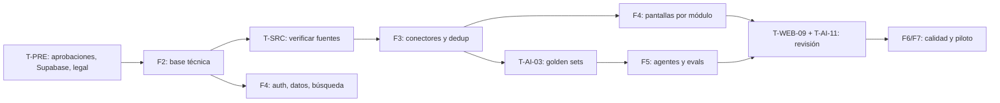

# Backlog técnico — Ventana A

| Campo | Valor |
|---|---|
| Documento | `docs/sprint-0/backlog-tecnico.md` |
| Versión | 0.1.0 (Sprint 0) |
| Fecha | 2026-11-15 |
| Autor | Ventana A |
| Estado | **PROPUESTA para aprobación**. Nada está empezado |
| Complemento | `docs/sprint-0/backlog-producto.md` (Ventana B; ya existe, no se revisó su contenido en este turno) |

> **Cómo leer las estimaciones.** Son **días-persona de una sola persona con dominio**, redondeados, **sin datos históricos de velocidad**. Intervalo real esperable: ×0,6 a ×2. No sustituyen una estimación con equipo. El plan de 16 semanas del PM es una hipótesis "sujeta a validación de capacidad" (PM §12): este backlog ofrece insumos para validarla, **no la valida**. Las fases siguen el PM §12: **F2** Arquitectura, **F3** Fuentes, **F4** Plataforma web, **F5** IA (F1 = Sprint 0; F6/F7 pertenecen a calidad y piloto y se listan al final como dependencias).
> Riesgo: B=bajo, M=medio, A=alto. "Req." referencia los RF/RNF provisionales de B `[PENDIENTE SRS]`.

## 0. Prerrequisitos de Sprint 1 (bloquean todo lo demás)

| ID | Tarea | Módulo | Dependencia | Días | Riesgo | Criterio de terminado | Responsable |
|---|---|---|---|---|---|---|---|
| T-PRE-01 | Aprobación del usuario de ADR-0001…0006 | — | Revisión de Sprint 0 | 0,5 | B | ADRs en estado `ACEPTADO` o con cambios solicitados, firmados en `BANDEJA.md` | Usuario |
| T-PRE-02 | Entregar SRS y Plan Maestro, o aprobar seguir solo con el PM | — | — | — | A | B-001/B-002 cerrados con evidencia (archivos en `docs/requisitos/`) o decisión escrita | Usuario |
| T-PRE-03 | Confirmar/crear proyecto Supabase de este producto | Infra | — | 0,5 | A | `get_project_url` responde y el proyecto es el acordado; B-003 cerrado con evidencia | Usuario + A |
| T-PRE-04 | Primer commit del repositorio (tras revisar secretos) | Repo | T-PRE-01 | 0,25 | B | `git log` con 1 commit; `gitleaks`/revisión manual sin hallazgos; B-005 cerrado | Usuario |
| T-PRE-05 | Contratar revisión legal inicial (L-01…L-12 de SEGURIDAD §7) | Legal | — | externo | A | Memorándum del abogado archivado; `REQUIERE ABOGADO` reducidos o resueltos fila por fila | Usuario |
| T-PRE-06 | Elegir proveedor LLM y presupuesto mensual | IA | — | 0,5 | M | Variables `AI_*` definidas (sin secretos en repo); tope aprobado | Usuario |
| T-PRE-07 | Decidir hosting web y de workers (ADR-0005) | Infra | T-PRE-01 | 0,5 | M | ADR-0005 `ACEPTADO` | Usuario |

## 1. Fase 2 — Arquitectura y base técnica

| ID | Tarea | Módulo | Dependencia | Días | Riesgo | Criterio de terminado | Req. |
|---|---|---|---|---|---|---|---|
| T-INF-01 | Prueba de humo de Supabase en rama/proyecto de pruebas: confirmar extensiones (`pg_trgm`, `pg_cron`, `pgvector`), `BYPASSRLS` de `service_role`, nombres de GUC del JWT, privilegios por defecto | Datos | T-PRE-03 | 1 | A | Informe con salida real de cada comprobación; cada `[VERIFICAR Sprint 1]` del SQL cerrado o ajustado | — |
| T-INF-02 | Ejecutar `schema-propuesto.sql` en una base vacía (Postgres 15+ y Supabase de pruebas) y corregir errores | Datos | T-INF-01 | 1,5 | M | Script corre sin error; conteo de 23 tablas con RLS (consulta de `MODELO-DATOS.md`); migración guardada en `supabase/migrations/` | RNF-24 |
| T-INF-03 | Suite de pruebas RLS rol × tabla × operación (T-DB-01…03) | Datos | T-INF-02 | 3 | M | Matriz de `MODELO-DATOS.md` §7.1 convertida en pruebas; 0 casos indebidos; informe archivado | RNF-24, AC-MVP-13 |
| T-INF-04 | CI mínima (lint, tipos, `vitest`, escaneo de secretos, `npm audit`) en GitHub Actions | Infra | T-PRE-04, SG-04 | 1,5 | B | Pipeline verde en un PR de prueba; secretos de ejemplo detectados por el escáner (prueba negativa) | RNF-26, RNF-34 |
| T-INF-05 | Esqueleto del monolito modular: carpetas de módulos, regla de lint de imports (A–F no se leen entre sí), configuración tipada de entorno con `zod` | Core | T-PRE-01 | 2 | B | `npm run lint`/`build` pasan; prueba que viola la regla de imports falla | — |
| T-INF-06 | Leer `node_modules/next/dist/docs/` relevante y registrar convenciones de Next 16 que afecten a auth, cookies, middleware/proxy y caché | Core | — | 1 | M | Nota en `docs/arquitectura/` (Ventana A) con rutas de los documentos leídos y decisiones | RT-09 |
| T-INF-07 | Observabilidad base: logs estructurados con `request_id`, Sentry (variable ya prevista), 4 alertas mínimas | Infra | T-INF-05 | 2 | M | Fallo simulado genera alerta (acta del simulacro) | RNF-35 |
| T-INF-08 | Entornos: staging y producción separados, secretos por entorno, política de datos `is_demo` | Infra | T-PRE-07 | 2 | M | Documento de despliegue + variables por entorno verificadas; sin secretos en repo | PM §10 |
| T-INF-09 | Cola `ingestion_jobs`: funciones de reclamo (`FOR UPDATE SKIP LOCKED`), lease y reintentos, con pruebas de concurrencia | Ingest | T-INF-02 | 2 | M | Prueba: 2 workers simultáneos no toman el mismo job; job con lease vencido se reasigna | RNF-07 |
| T-INF-10 | Autenticación (registro, verificación de correo, login, recuperación) con RLS de `users` y creación de perfil | Core | T-INF-02, T-INF-06 | 3 | M | AC-MVP-01 verificado; `viewer` no accede a `/admin` (403) | RF-G-01, AC-MVP-10 |

Subtotal F2: ≈ 19 días-persona.

## 2. Fase 3 — Integración de fuentes

Cada conector exige antes su tarea de verificación `T-SRC-*` (FUENTES-RD §14). **Sin esa verificación, el conector no se activa** (`CHECK` en `sources`).

| ID | Tarea | Módulo | Dependencia | Días | Riesgo | Criterio de terminado | Req. |
|---|---|---|---|---|---|---|---|
| T-SRC-01 | Verificar DGCP: leer `datosabiertos.dgcp.gob.do`, su `robots.txt`, frecuencia real, tamaño incremental | Fuentes | — | 0,5 | M | Ficha F-01 actualizada con evidencia; contradicción de frecuencia resuelta | RF-D-01 |
| T-SRC-02 | Verificar BCRD: términos (`/a/d/3894`), calendario de publicación, páginas de subastas, contacto para API | Fuentes | — | 0,5 | M | Ficha F-02 actualizada | RF-C-01 |
| T-SRC-03 | Verificar Crédito Público: RSS, privacidad, servicios de inversionistas | Fuentes | — | 0,5 | B | Ficha F-03 actualizada | RF-C-02 |
| T-SRC-04 | Verificar MIMARENA: formato real de descargas WPFD, `serviciosdigitales` y su robots/términos | Fuentes | — | 1 | M | Ficha F-04 con formato y campos disponibles (¿proyecto, promotor, monto, estado?) | RF-B-01 |
| T-SRC-05 | Verificar CNE desde navegador real / contacto institucional | Fuentes | — | 1 | A | Ficha F-05 con API/formato o decisión "manual" | RF-B-01 |
| T-SRC-06 | Verificar SIMV (registro y hechos relevantes) | Fuentes | — | 1 | A | Ficha F-06 completa o "manual" | RF-C-03 |
| T-SRC-07 | BVRD: aclarar licencia/acuerdo; decidir "solo enlace" | Fuentes | T-PRE-05 | 1 | A | Decisión escrita; ficha F-07 | RF-C-03 |
| T-SRC-08 | ProDominicana: leer `/news`, términos, evaluar como fuente de señales | Fuentes | — | 0,5 | M | Ficha F-08 completa | RF-E-01 |
| T-SRC-09 | `datos.gob.do`: comprobar si es CKAN y qué publica | Fuentes | — | 0,5 | M | Ficha F-09 completa | — |
| T-ING-01 | Framework de conector: cliente HTTP seguro (lista de hosts, DNS validado, límites, `robots.txt`, `User-Agent`), con pruebas SSRF | Ingest | T-INF-09, SG-05 | 4 | A | S-T-04 pasa (IP privadas, metadata, redirecciones, DNS rebinding) | PM §10 |
| T-ING-02 | Almacenamiento de originales (hash, Storage, `source_documents` inmutable) + carga manual desde panel admin | Ingest | T-INF-02 | 3 | M | Reingesta del mismo archivo no duplica (RNF-06); carga manual registra actor | RF-A-01, A-04 |
| T-ING-03 | Conector DGCP OCDS bulk (streaming `.jsonl.gz`) → `public_tenders`/`contracts`/`organizations` | Ingest/D | T-SRC-01, T-ING-01, T-ING-02 | 6 | A | Carga completa y luego incremental sin duplicados; memoria pico medida; `data_quality_flags` poblado | RF-D-01…D-06 |
| T-ING-04 | Conector Crédito Público (listado → PDF/XLSX) → `instrument_auctions` | Ingest/C | T-SRC-03, T-ING-01, T-ING-02 | 5 | M | Resultados de subasta reconstruidos desde XLSX consolidado; `rate_kind='awarded'`; cada fila cita su documento | RF-C-01, C-08 |
| T-ING-05 | Conector BCRD (XLS/XLSX con validación de esquema) | Ingest/C | T-SRC-02, T-ING-01 | 5 | A | Un cambio de columnas produce `failed_schema` y alerta (prueba con archivo alterado) | RF-C-01 |
| T-ING-06 | Procedimiento manual asistido para CNE/SIMV/BVRD/MIMARENA (si no hay vía automática): formulario de carga, plantilla de metadatos, checklist | Ingest | T-ING-02, T-SRC-04…07 | 3 | M | Un operador carga un documento y aparece con evidencia y actor; manual de procedimiento | S-05 de B |
| T-ING-07 | Conector MIMARENA (descargas WPFD) si es automatizable | Ingest/B | T-SRC-04, T-ING-01 | 4 | A | Condicional: solo si T-SRC-04 lo permite | RF-B-01 |
| T-ING-08 | Programador: encola jobs por fuente (`pg_cron` o cron externo con `INGESTION_CRON_SECRET`) | Ingest | T-INF-09 | 2 | M | Jobs creados por fuente y ventana; idempotente al repetir | RF-A-01 |
| T-ING-09 | Deduplicación de eventos/organizaciones (claves y candidatos de fusión reversibles) | A/E | T-ING-03 | 4 | M | Prueba con casos de duplicado conocidos; fusión y deshacer auditados; métrica de duplicados medida (meta B ≤ 2 %) | RF-A-04, E-08, RNF-12 |
| T-ING-10 | Catálogos: siembra de `geographic_locations` desde fuente oficial **[fuente PENDIENTE]** | Datos | T-SRC-* | 2 | M | Provincias/municipios cargados con `coordinates_source`/`official_code` y cita | RF-B-07 |
| T-ING-11 | Panel de salud de ingesta (frescura, fallos, cola) | Admin | T-ING-08 | 2 | B | Datos reales de jobs visibles; alerta de fuente sin datos | RNF-15 |

Subtotal F3 (verificaciones 6,5 + conectores y comunes 40): ≈ 47 días-persona. **Cobertura realista** de módulos B/E depende de T-SRC-04…06; si resultan manuales, la automatización de esos módulos queda fuera del MVP (cobertura declarada por fuente, RF-B-01).

## 3. Fase 4 — Plataforma web (parte técnica; el diseño lo define B)

| ID | Tarea | Módulo | Dependencia | Días | Riesgo | Criterio de terminado | Req. |
|---|---|---|---|---|---|---|---|
| T-WEB-01 | Capa de acceso a datos tipada por módulo (consultas, validación `zod`, paginación obligatoria) | Core | T-INF-05, T-INF-02 | 4 | M | Pruebas unitarias; ninguna consulta sin `LIMIT` | RNF-02 |
| T-WEB-02 | Búsqueda de texto completo + facetas (`tsvector`, `pg_trgm`) y benchmark | A/Core | T-WEB-01, T-ING-03 | 4 | M | `EXPLAIN` de 10 consultas + k6 con dataset sintético; contra RNF-03 | RF-A-08, RF-G-04, RNF-03 |
| T-WEB-03 | Radar y detalle de evento con evidencia, fechas y capa de confianza (consumo de contratos de datos; UI por B) | A | T-WEB-01 | 5 | B | AC-MVP-02 | RF-A-* |
| T-WEB-04 | Proyectos y permisos con máquina de estados y restricciones | B | T-WEB-01 | 5 | M | AC-MVP-03 | RF-B-* |
| T-WEB-05 | Licitaciones (cuenta atrás, estados, alertas de plazo) | D | T-ING-03 | 4 | B | AC-MVP-04; fechas con zona | RF-D-* |
| T-WEB-06 | Instrumentos, historial y comparador (sin "comprar"); `rate_kind` visible | C | T-ING-04 | 5 | M | AC-MVP-05 | RF-C-* |
| T-WEB-07 | Fichas de empresa (`organizations`) y relaciones | E | T-ING-09 | 4 | M | RF-E-03 verificado | RF-E-* |
| T-WEB-08 | Watchlist, preferencias y centro de alertas (in-app) | Alerts | T-INF-10 | 5 | M | AC-MVP-08, AC-MVP-09; prueba de no-duplicado | RF-G-06…08 |
| T-WEB-09 | Panel administrativo: fuentes, jobs, cola de revisión, usuarios/roles (`app.set_user_role`), auditoría | Admin | T-INF-10, T-ING-11 | 6 | M | 403 a no-admin; cambios de rol quedan en `audit_logs` | RF-G-12, G-13 |
| T-WEB-10 | Cabeceras de seguridad, CSP, rate limiting y validación en todas las rutas | Seguridad | T-INF-05, T-PRE-07 | 3 | M | S-T-08 y S-T-09 pasan | RNF-23 |
| T-WEB-11 | Dashboard (KPIs, vencimientos, frescura) | Core | T-WEB-03…06 | 3 | B | RF-G-10; datos `is_demo` excluidos de KPIs | RF-G-10 |
| T-WEB-12 | Mapa de proyectos (Could) | B | T-ING-10 | 3 | B | Solo si hay coordenadas con fuente; si no, agrupar por provincia | RF-G-11 |

Subtotal F4: ≈ 51 días-persona.

## 4. Fase 5 — Inteligencia artificial

| ID | Tarea | Módulo | Dependencia | Días | Riesgo | Criterio de terminado | Req. |
|---|---|---|---|---|---|---|---|
| T-AI-01 | Interfaz `LlmClient` + registro en `ai_analysis_runs` (tokens, costo, hashes) + presupuesto duro | ai | T-PRE-06, T-INF-02 | 4 | M | Llamada de prueba registra modelo/versión/costo; al superar el tope se bloquea | RN-12, RNF-21 |
| T-AI-02 | Verificador literal de citas y validador de esquemas | ai | T-AI-01 | 3 | B | Pruebas: cita inexistente rechazada; JSON inválido rechazado | RNF-18 |
| T-AI-03 | Construcción de `golden_extraction`/`classification`/`verification` (anotación humana) | ai | T-ING-03…06 | 8 | A | Conjuntos versionados con acuerdo entre anotadores medido | RNF-16, 17 |
| T-AI-04 | Agente Extraction (prompts, esquemas, troceado) | ai | T-AI-02, T-AI-03 | 6 | A | Evals contra `golden_extraction`; informe con métricas **reales** (sin declarar cumplimiento si no llega al umbral) | RNF-16 |
| T-AI-05 | Clasificación sectorial | ai | T-AI-03 | 3 | M | macro-F1 y recall por clase medidos | RNF-17 |
| T-AI-06 | Agente Verification (reglas deterministas + LLM opcional) | ai | T-AI-04 | 5 | A | 0 falsos `verified` en casos de contradicción del golden set | RF-A-11 |
| T-AI-07 | Suite adversarial de prompt injection (≥ 30) y controles I-1…I-12 | ai/Seg | T-AI-04 | 3 | A | S-T-05: 100 % sin ejecutar instrucciones | RNF-20 |
| T-AI-08 | Agente Opportunity Intelligence + cálculo de `confidence` + flujo draft→in_review→published (trigger ya en SQL) | F | T-AI-06 | 6 | A | AC-MVP-06; publicación bloqueada sin cita literal | RF-F-* |
| T-AI-09 | Librería de cálculo financiero determinista + pruebas | C | decisión V-05 de B | 4 | M | `regression_financial` (≥ 30) pasa | RF-C-07 |
| T-AI-10 | Agente Alert (reglas) + deduplicación y entrega in-app | Alerts | T-WEB-08 | 3 | M | Mismo evento no genera 2 alertas; entrega medida | RF-A-09, RNF-08 |
| T-AI-11 | Cola de revisión humana (UI en admin) y registro de decisiones | Admin | T-AI-08, T-WEB-09 | 4 | M | Decisión crea `verification_records` y `audit_logs` | RF-F-11 |
| T-AI-12 | Evals en CI, informe de costos por agente | ai | T-AI-04…08 | 3 | M | Cambio de prompt/modelo dispara evals; despliegue se bloquea bajo umbral | RNF-19, 21 |

Subtotal F5: ≈ 52 días-persona.

## 5. Dependencias de fases 6 y 7 (no estimadas aquí)

Pruebas unitarias/integración/E2E, seguridad y carga (`docs/qa/ESTRATEGIA-PRUEBAS.md`, Ventana B), simulacro de restauración (RNF-09), runbooks (RNF-36), piloto cerrado, revisión legal previa al lanzamiento (RNF-27).

## 6. Orden de implementación propuesto

Camino crítico: **T-PRE-02/03 → T-INF-01/02/03 → T-ING-01/02 → T-ING-03 (DGCP) → T-AI-03 → T-AI-04 → T-AI-06 → T-AI-08 → T-AI-11**.

Razones del orden:

1. **Primero lo que puede invalidar el diseño:** la prueba de humo de Supabase y la ejecución real del SQL (T-INF-01/02), y la verificación de fuentes (T-SRC-*). Si una fuente es manual, cambia el alcance de B/E.
2. **Una fuente sólida antes que muchas:** DGCP (F-01) tiene evidencia suficiente; sirve de caso de prueba del framework de ingesta y del dedup.
3. **Golden sets antes que prompts:** no se afinan agentes sin conjunto de evaluación, para no "ajustar a ojo".
4. **Seguridad desde el principio** (RLS, SSRF, secretos) y no al final (Fase 6).
5. La IA entra **después** de tener documentos reales y la cola de revisión: así el MVP funciona con revisión humana desde el día 1.

## 7. Resumen de esfuerzo (solo tareas de este backlog)

| Bloque | Días-persona (estimación bruta) |
|---|---|
| F2 | ≈ 19 |
| F3 | ≈ 47 |
| F4 (técnico) | ≈ 51 |
| F5 | ≈ 52 |
| **Total (original, ver §9 para el total revisado ≈ 192,5)** | **≈ 168 días-persona** |

Equivale a **~34 semanas de una persona** o **~16 semanas con ~2 personas a plena dedicación y sin retrasos**, **sin contar** Fase 6, Fase 7, diseño/UX (B), legal ni los vacíos de la SRS. **Conclusión honesta:** con 1–2 personas, las 16 semanas del PM **no son realistas para todo el alcance**; son plausibles solo si el MVP se recorta (p. ej. fuentes manuales para B/E, comparador y calculadora fuera, mapa fuera) o si hay un equipo mayor. Se recomienda que el usuario decida recortes tras ver T-SRC-04…06. Esta cifra es una **hipótesis a validar**, no un compromiso.

## 8. Riesgos del backlog

| ID | Riesgo | Mitigación |
|---|---|---|
| RB-01 | CNE/SIMV/BVRD/MIMARENA resultan manuales | Declarar cobertura parcial; procedimiento manual (T-ING-06) |
| RB-02 | Golden set inviable (pocas muestras, licencias) | Empezar con DGCP/Crédito Público/MIMARENA; ampliar con revisión |
| RB-03 | Decisiones del usuario retrasadas (T-PRE-*) | Priorizar T-PRE-02, 03, 05 |
| RB-04 | Estimaciones sin base histórica | Re-estimar tras Sprint 1 con velocidad real |
| RB-05 | La SRS cambia el modelo de datos | No congelar `schema-propuesto.sql` hasta T-PRE-02 |

## 9. Ronda 2 — habilitadores de B y tareas de conciliación (añadido 2026-11-15)

> Estimaciones en **días-persona** (misma escala y mismas reservas que el resto de este documento). Los habilitadores EN-01…EN-08 son de `backlog-producto.md` §3.1 (B no los estimó). Cuando ya existe tarea equivalente arriba, **no se duplica**.

| ID | Tarea | Equivale a | Módulo | Dependencia | Días | Riesgo | Criterio de terminado |
|---|---|---|---|---|---|---|---|
| T-EN-01 | Sistema de diseño implementado: tokens claro/oscuro, Tailwind 4, `TrustLayerBadge`, `MetricValue`, `EvidencePanel`, `DataTable`/`DataCard`, estados vacío/carga/error | EN-01 | Web | T-INF-05, T-INF-06 (leer docs de Next 16/Tailwind 4) | 8 | M | Componentes con pruebas; contraste de tokens medido con herramienta (no solo el cálculo de diseño); capas distinguibles en escala de grises |
| (ya estimado) T-INF-04 | CI + Vitest + escaneo de secretos | EN-02 | Infra | T-PRE-04 | 1,5 (+0,5 configurar Vitest) = 2 | B | CI verde; secreto de prueba detectado |
| T-EN-03 | Datos sintéticos `is_demo` con semilla fija y catálogo de datasets de prueba (incl. el de RNF-02/03) | EN-03 | Datos | T-INF-02 | 4 | M | Generador reproducible; dataset marcado `is_demo`; excluido de KPIs (prueba) |
| (ya estimado) T-AI-03 + T-AI-12 | Golden sets y arnés de evals | EN-04 | IA | T-ING-03…06, **B-015** (anotadores) | 8 + 3 = 11 | A | Ver §4; **sin anotadores designados no empieza** |
| (ya estimado) T-INF-07 | Observabilidad base y 4 alertas | EN-05 | Infra | T-INF-05 | 2 | M | Simulacro de fallo con alerta |
| T-EN-06 | Runbooks (ingesta, IA, alertas, backups) y ensayo de rollback en staging | EN-06 | Infra | T-PRE-07 (ADR-0005), T-INF-08 | 4 | M | Acta de ensayo de rollback con tiempos reales |
| T-EN-07 | Simulacro de backup/restauración | EN-07 | Infra | T-PRE-03; plan de Supabase `[VERIFICAR]` | 2 | A | Acta con RPO/RTO medidos (B: ≤ 24 h / ≤ 4 h) |
| T-EN-08 | Documentos raíz del PM §14 como **índices** que enlazan a los archivos reales (D-001) | EN-08 | Docs | Aprobación de Sprint 0 | 0,5 | B | Índices creados sin duplicar contenido |
| T-WEB-13 | **Historial público** de cambios (RF-A-12, RF-B-06): endpoint de servidor con lista blanca de columnas y solo filas publicadas; no se lee `audit_logs` desde el cliente | — (respuesta al punto 7 de B) | Web/Datos | T-INF-02, T-WEB-04 | 3 | M | Un `viewer` ve el historial de un proyecto publicado y **no** el de borradores (prueba); sin campos personales |
| T-INF-11 | Conciliar modelo con fichas de B (propuestas DIS-02…DIS-07 de `CONCILIACION-A-B.md`): `verification_status` en otras entidades, `CHECK` de documento por estado, restricción de fusión a `platform_admin`, visibilidad de `ingestion_jobs` | — | Datos | Decisión del usuario sobre DIS-02…DIS-07 | 2 | M | SQL actualizado y ejecutado en Postgres de pruebas; casos negativos pasan |

**Nuevo total de este backlog:** 168,5 (original) + 8 + 0,5 (Vitest) + 4 + 4 + 2 + 0,5 + 3 + 2 = **≈ 192,5 días-persona** (se descuentan los habilitadores ya estimados arriba). No incluye QA E2E/A11Y/carga/DAST, pruebas de usabilidad, revisión legal, piloto ni Fase 6/7. Comparación con el roadmap de B: `docs/sprint-0/CONCILIACION-A-B.md` §3.
